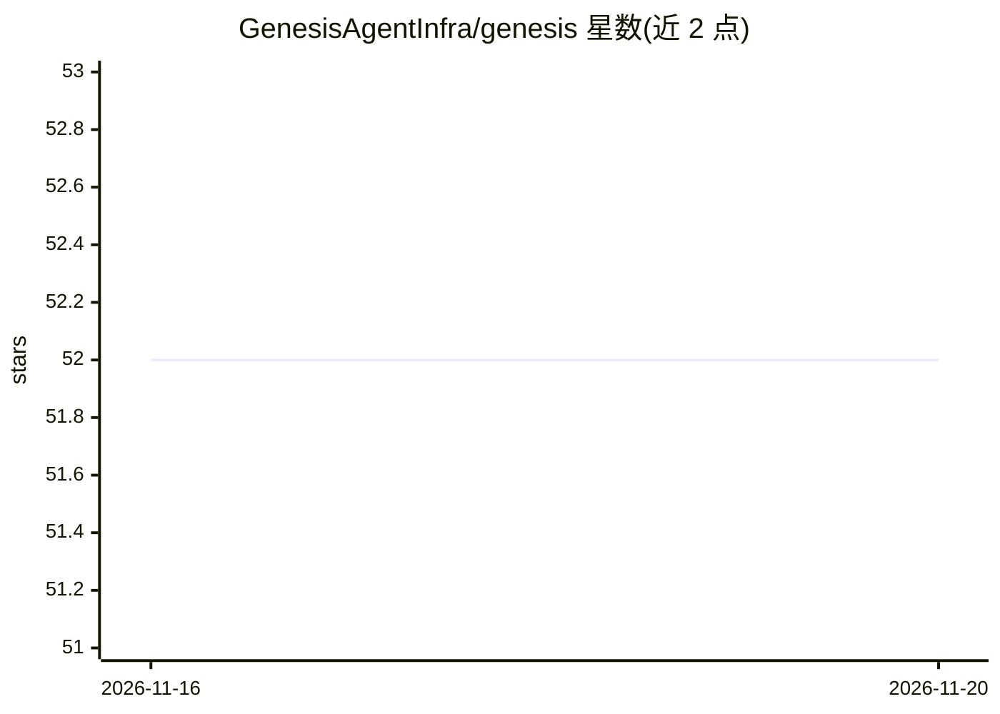

# GenesisAgentInfra/genesis

⭐ — · [GitHub]() · 组织维护 · 中文 README

**把代码库变成业务流程图的 agent 技能，标出未测试/有风险的改动**

以 Claude Code 与 Codex 技能形式运行的工具：将代码库绘制为业务流程图，agent 修改后可对照指定修订版本（如 main）逐项显示改动是否被测试覆盖。信任机制上，agent 写的每个步骤须引用对应代码行，Genesis CLI 将引文与仓库冻结快照比对，不匹配则拒绝整段描述并要求重试；对 Python 还会自行解析代码，agent 漏掉的分支会标记 partial。CLI 自身不调用模型、不联网、不运行用户代码。限制：非 Python 语言依赖 agent 阅读，漏读路径不会被标记；测试结论来自阅读测试而非运行。安装需 git clone 后用 uv 构建并注册到 agent。

## 筛选速览

| 维度 | 判定 | 备注 |
|---|---|---|
| AI 角色 | `ai-ecosystem` | LLM/agent 周边工具 |
| 许可风险 | `permissive` | — |
| 部署形态 | `None` |  |
| 模型依赖 | locked-api |  |
| 硬件要求 | — | 无带数字的原话,不猜 |
| 安装摩擦 | `low` | 无编译、无系统依赖或容器化 |
| 成熟度 | — | 结构信号不足 |

## 能力要点

- 流程图上逐项标注改动的测试覆盖判定（未触达/仅触达/覆盖/未知）
- agent 描述的代码引文须与仓库冻结快照比对，不匹配即拒绝
- Python 代码由 CLI 自行解析，漏读分支标记 partial
- CLI 不调用模型、不发送数据、不运行用户代码

## 适用场景

- review agent 批量改动时快速定位未被测试覆盖的部分
- 生成可粘贴进 PR 的 summary.md 与 view.html 可视化
- 理解既有代码库当前的业务流程结构

## 场景标签

`代码审查` · 领域:编码与开发

## 证据(README 行号)

> L17: Genesis turns your codebase into a business flow map and shows which of your agent's
> L18: changes are untested or risky. It runs as a skill inside Claude Code and Codex.
> L65: Your agent does the reading, but it doesn't get the last word. Every step it writes has

## 星数曲线

2026-11-16 52 → 2026-11-20 52（+0）

---
*卡片 v1 · prompt 1.4 · 生成 2026-11-18 · 置信度 high · 依据 README sha `7939a0b563d8` · [字段定义](../../DATASET.md)*
