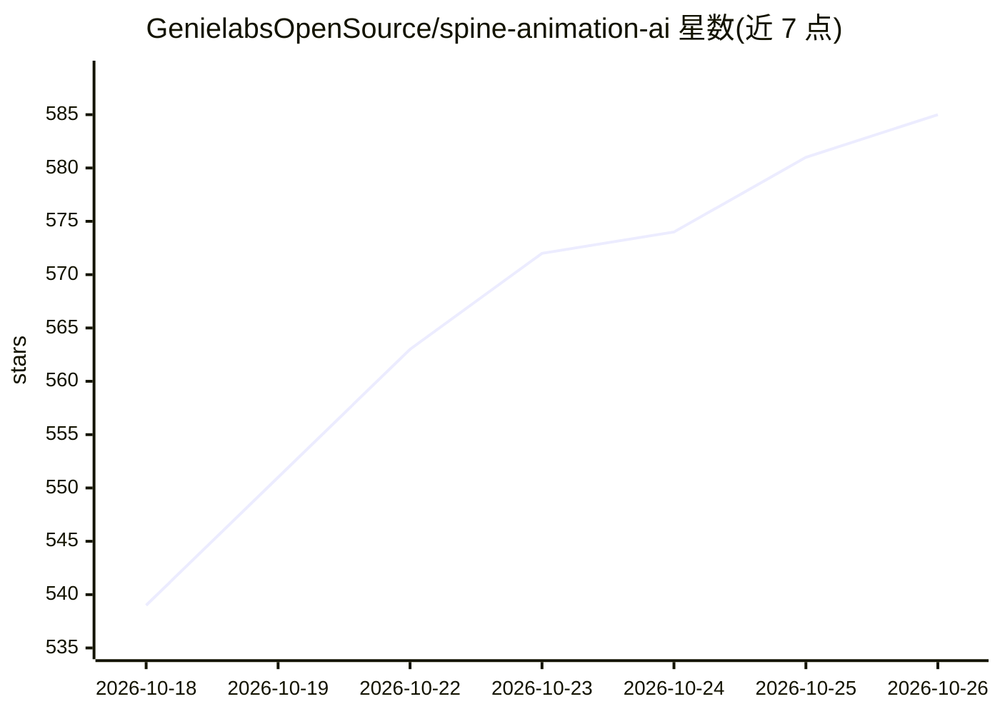

# GenielabsOpenSource/spine-animation-ai

⭐ 585 · Python · NOASSERTION · 推送 2026-08-26 · [GitHub](https://github.com/GenielabsOpenSource/spine-animation-ai) · [官网](https://GenielabsOpenSource.github.io/spine-animation-ai/demo/sombrero_idle.html) · 组织维护

**让 Claude 自动完成 Spine 2D 骨骼动画绑定与生成的技能**

面向 Spine 2D 动画制作者的 Claude agent 技能：提供 SKILL.md，可粘贴进 Claude Projects 或挂载到支持技能目录的 Claude 环境。能力包括基于 SIFT+RANSAC 的身体部件自动定位、生成骨骼 JSON 与纹理图集、按动画十二原则生成 idle/walk/run 等预设动画、输出自包含 HTML5 预览，以及 AI 辅助的骨骼偏移修正。另提供无 Claude 的手动 Python 流水线，单图拆件需 Gemini API key。许可为 PolyForm 非商业，商用需另行联系。

## 筛选速览

| 维度 | 判定 | 备注 |
|---|---|---|
| AI 角色 | `ai-native` | 本体是模型或模型工具 |
| 许可风险 | `none` | NOASSERTION |
| 部署形态 | `library` | 以包/库形式分发 |
| 模型依赖 | locked-api |  |
| 硬件要求 | — | 无带数字的原话,不猜 |
| 安装摩擦 | `low` | 无编译、无系统依赖或容器化 |
| 成熟度 | — | 结构信号不足 |

## 能力要点

- SIFT+RANSAC 两阶段自动定位身体部件并推断绘制顺序
- 按动画十二原则生成 6 种动画预设（idle/walk/run/wave/jump/attack）
- SKILL.md 自包含嵌入全部脚本，粘贴进 Claude Projects 即可用
- 提供不依赖 Claude 的手动 Python 流水线（可选 Gemini 拆件）

## 适用场景

- 把拆好的角色部件图交给 Claude 自动搭建 Spine 骨骼并生成动画
- 已有 Spine 工程时让 AI 修正部件偏移并补充动画
- 游戏开发前快速生成交互式 HTML 预览验证角色效果

## 场景标签

`图像视频处理` · 领域:感知与多模态

## 证据(README 行号)

> L3: > An AI-powered Claude skill for creating, rigging, and refining Spine 2D skeletal animations — from raw assets to i
> L40: **Spine Animation AI** is a Claude agent skill that lets AI handle the tedious parts of Spine 2D animation producti
> L44: - **Generate animations** (idle, walk, run, attack, wave, jump) using the 12 principles of animation

## 星数曲线

2026-10-18 539 → 2026-10-26 585（+46）

---
*卡片 v1 · prompt 1.4 · 生成 2026-10-21 · 置信度 mid · 依据 README sha `0652baaef4cf` · [字段定义](../../DATASET.md)*
