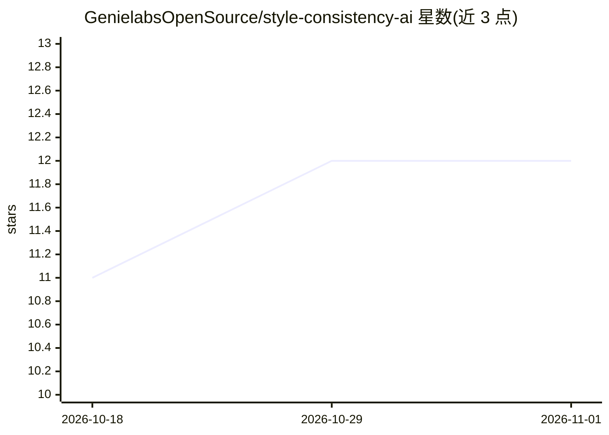

# GenielabsOpenSource/style-consistency-ai

⭐ 12 · NOASSERTION · 推送 2026-08-01 · [GitHub](https://github.com/GenielabsOpenSource/style-consistency-ai) · 组织维护

**保持 AI 生成角色/画风一致性的 Claude Agent 技能包（免训练）**

由 Genielabs 开源的一组 Agent Skills（SKILL.md 格式的 Markdown 指令集）：通过"最小增量编辑、参考图集、纠正性规则、按任务选模型、失败才升级"的训练免 LoRA 工作流，让 AI 图像生成中的角色、物体和场景保持设定一致。已提供 character-consistency 与 model-integration 两个技能（后者检测并路由 Gemini/fal.ai/Replicate/OpenAI/xAI 等提供方），背景/物体/视频一致性技能为规划状态。技能无运行时依赖，可装入 Claude Code/Projects 或用 Agent SDK 自建 agent。许可证为 PolyForm Noncommercial，商用需联系维护方。

## 筛选速览

| 维度 | 判定 | 备注 |
|---|---|---|
| AI 角色 | `ai-knowledge` | 知识聚合/清单类 |
| 许可风险 | `none` | NOASSERTION |
| 部署形态 | `None` |  |
| 模型依赖 | — | README 未给出锁定关系 |
| 硬件要求 | — | 无带数字的原话,不猜 |
| 安装摩擦 | `low` | 无编译、无系统依赖或容器化 |
| 成熟度 | — | 结构信号不足 |

## 能力要点

- 免 LoRA 训练的角色一致性工作流（含逐次生成-校验-修复循环）
- model-integration 技能检测可用提供方并按任务路由（Gemini/fal.ai/Replicate/OpenAI/xAI）
- 技能为纯 Markdown、无运行时依赖，兼容 SKILL.md 约定的任意 agent
- 背景/物体/视频一致性技能处于规划状态

## 适用场景

- 让 Claude 类 agent 生成连载角色时保持画风与设定一致
- 为角色生成产品构建自建 agent 的核心指令层
- 游戏/创意团队在不训练 LoRA 的前提下维持品牌视觉一致性

## 场景标签

`Agent 框架` `图像生成` · 领域:Agent 开发

## 证据(README 行号)

> L63: Drop a skill into any skills-aware agent (Claude Code, Claude Projects, or anything that reads the `SKILL.md` conve
> L83: The skills are plain Markdown with no runtime dependencies, so they port to any framework that can follow instructi
> L107: Each skill follows the Agent Skills convention: a `SKILL.md` with YAML frontmatter (`name`, `description`) that co

## 星数曲线

2026-10-18 11 → 2026-11-01 12（+1）

---
*卡片 v1 · prompt 1.4 · 生成 2026-11-01 · 置信度 high · 依据 README sha `bf33e513e0b2` · [字段定义](../../DATASET.md)*
