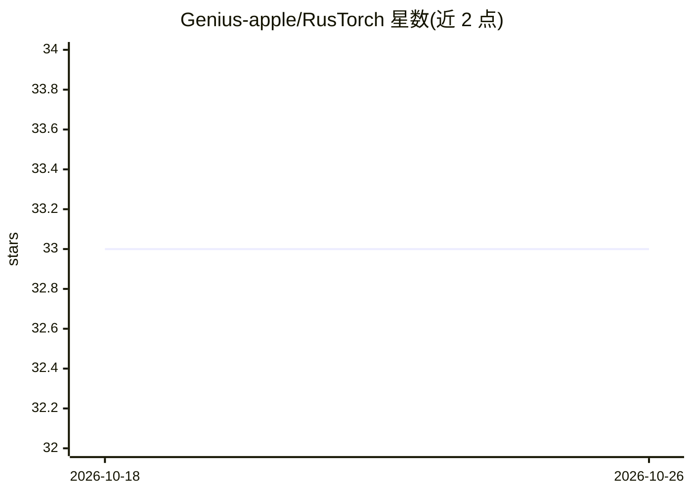

# Genius-apple/RusTorch

⭐ 33 · Rust · MIT · 推送 2026-03-16 · [GitHub](https://github.com/Genius-apple/RusTorch) · 组织维护

**Rust 实现的类 PyTorch 深度学习框架**

以 Rust 编写的深度学习框架，采用 PyTorch 风格 API，提供 N 维张量、Autograd 引擎、JIT 图编译（算子融合）、Rayon 并行 CPU 执行与 DistributedDataParallel 分布式训练。工作区包含 core/nn/vision/text 模块及 CUDA、WASM、WebGPU、Vulkan 后端，另有 PyTorch 桥接包可加载 .pth 权重并做 Tensor 零拷贝转换。面向 Rust 开发者，通过 Cargo.toml 以 rus-torch crate 形式引入，许可为 MIT 或 Apache-2.0。README 未给出完整训练示例代码与基准数据。

## 筛选速览

| 维度 | 判定 | 备注 |
|---|---|---|
| AI 角色 | `ai-ecosystem` | LLM/agent 周边工具 |
| 许可风险 | `permissive` | MIT |
| 部署形态 | `library` | 以包/库形式分发 |
| 模型依赖 | — | README 未给出锁定关系 |
| 硬件要求 | — | 无带数字的原话,不猜 |
| 安装摩擦 | `medium` | 含编译或系统依赖之一 |
| 成熟度 | — | 结构信号不足 |

## 能力要点

- PyTorch 风格 API 与 Autograd 引擎
- JIT 图编译：算子融合与死代码消除
- 多后端：CUDA、WASM、WebGPU、Vulkan
- PyTorch 桥接：加载 .pth 权重与 Tensor 零拷贝互转

## 适用场景

- 在 Rust 项目中训练与部署神经网络
- 将 PyTorch 训练的模型迁入 Rust 运行时
- 在浏览器经 WASM/WebGPU 运行模型

## 场景标签

`模型训练` `推理引擎` · 领域:训练与推理

## 证据(README 行号)

> L10: **RusTorch** is a production-grade deep learning framework re-imagined in Rust. It combines the **usability** you l
> L42: * **`rustorch-core`**: The heart. N-dimensional Tensors, Autograd engine, and JIT compiler.

## 星数曲线

2026-10-18 33 → 2026-10-26 33（+0）

---
*卡片 v1 · prompt 1.4 · 生成 2026-10-25 · 置信度 high · 依据 README sha `b3b2bf8f029e` · [字段定义](../../DATASET.md)*
