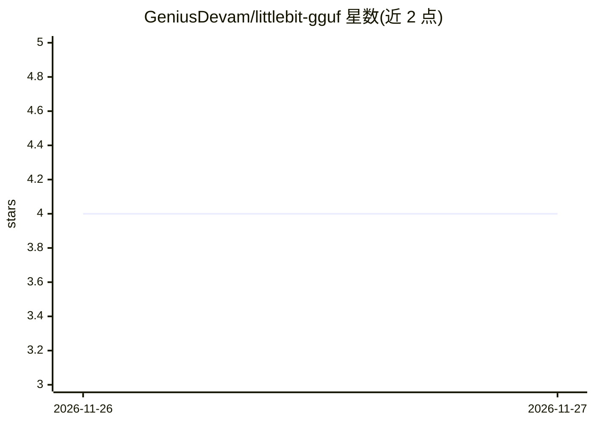

# GeniusDevam/littlebit-gguf

⭐ 4 · Python · MIT · 推送 2026-11-26 · [GitHub](https://github.com/GeniusDevam/littlebit-gguf) · [官网](https://huggingface.co/DaddyDevam/littlebit-qwen3-0.6b) · 个人维护

**在 llama.cpp 中以 Q1_0 格式运行 sub-1-bit LittleBit 模型**

独立研究项目：将 Samsung Research 的 LittleBit/LittleBit-2 sub-1-bit 架构转换并运行于 llama.cpp，复用其自带的 Q1_0 张量类型而非编写新内核。提供 GGUF 转换器（支持 F16/Q8_0/Q6_K/Q4_K 嵌入回退、tied embeddings、两种格式版本）、带补丁的 llama.cpp CPU 构建（覆盖 Llama/Qwen2/Qwen3），并附合成 checkpoint 生成器与测试。限制：上游合并前必须使用本仓库的补丁构建，标准 llama.cpp/Ollama/LM Studio 无法加载其 GGUF 文件；GPU 构建开关未经项目测试；架构覆盖尚不完整。

## 筛选速览

| 维度 | 判定 | 备注 |
|---|---|---|
| AI 角色 | `ai-ecosystem` | LLM/agent 周边工具 |
| 许可风险 | `permissive` | MIT |
| 部署形态 | `library` | 以包/库形式分发 |
| 模型依赖 | local-ok | 支持本地模型 |
| 硬件要求 | `cpu-ok` | |
| 安装摩擦 | `high` | 编译与系统依赖俱全 |
| 成熟度 | `idea` | |

## 能力要点

- 通过 Q1_0 块缩放折叠实现 LittleBit 层，无需新内核
- GGUF 转换器支持多种嵌入量化类型与两种格式版本
- 提供 CPU 补丁构建脚本、基准数据与已发布 checkpoint 校验
- 附合成 checkpoint 生成器（Dual-SVID 初始化）用于算术与运行时验证

## 适用场景

- 在 CPU 上以 0.1–1 bit 每权重运行 LittleBit 架构模型
- 将 LittleBit checkpoint 转换为 GGUF 并测量文件大小与吞吐
- 复现论文相关的量化与困惑度实验

## 场景标签

`推理引擎` `模型量化` · 领域:训练与推理

## 证据(README 行号)

> L3: Run **sub-1-bit LittleBit and LittleBit-2 language models in llama.cpp**, using the 1-bit `Q1_0` tensor type llama.c
> L50: |llama.cpp CPU patch|Done for Llama, Qwen2 and Qwen3 with projection inputs divisible by 128.|
> L56: Until the changes are upstream, LittleBit GGUF files need the patched build from this repo. Stock llama.cpp, Ollama

## 星数曲线

2026-11-26 4 → 2026-11-27 4（+0）

---
*卡片 v1 · prompt 1.4 · 生成 2026-11-26 · 置信度 mid · 依据 README sha `11aedea02386` · [字段定义](../../DATASET.md)*
