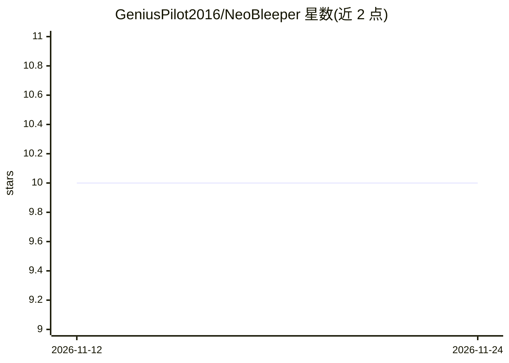

# GeniusPilot2016/NeoBleeper

⭐ 10 · C# · GPL-3.0 · 推送 2026-11-23 · [GitHub](https://github.com/GeniusPilot2016/NeoBleeper) · [官网](https://geniuspilot2016.wordpress.com/neobleeper/) · 个人维护

**用主板 PC 喇叭作曲的软件，支持 Gemini 生成音乐**

NeoBleeper 是一款运行于 Windows 的乐曲创作软件，通过访问主板系统喇叭（PC Speaker）的物理端口发声，解决新版 Windows 中蜂鸣声被转发到默认声音设备的问题；受 Bleeper Music Maker 启发并兼容其 .BMM 文件格式，同时使用自有 .NBPML 格式。提供音符添加与编辑、拍号/BPM 设置、虚拟键盘与普通键盘弹奏、界面个性化等功能。AI 部分为可选功能：接入 Google Gemini 生成乐曲，可通过系统喇叭或 MIDI 输出设备播放。提供 Releases 预编译可执行文件，免安装运行；项目处于 beta 阶段。

## 筛选速览

| 维度 | 判定 | 备注 |
|---|---|---|
| AI 角色 | `ai-enhanced` | 去掉 AI 部分产品仍成立 |
| 许可风险 | `viral` | GPL-3.0 |
| 部署形态 | `desktop` | 安装包/桌面程序 |
| 模型依赖 | — | README 未给出锁定关系 |
| 硬件要求 | — | 无带数字的原话,不猜 |
| 安装摩擦 | `low` | 无编译、无系统依赖或容器化 |
| 成熟度 | `idea` | |

## 能力要点

- 通过主板系统喇叭物理端口发声，兼容 .BMM 与 .NBPML 文件格式
- Google Gemini 驱动的 AI 乐曲生成，可经系统喇叭或 MIDI 设备播放
- 虚拟键盘与普通键盘钢琴输入，拍号/BPM 与节拍器设置
- 自动检测系统喇叭，缺失时切换到声音设备发声

## 适用场景

- 在主板的 PC 喇叭上创作和播放蜂鸣音乐
- 用 AI 生成简单旋律并通过系统喇叭或 MIDI 播放
- 打开和编辑 Bleeper Music Maker 的旧 .BMM 文件

## 场景标签

 · 领域:音乐创作/桌面工具

## 证据(README 行号)

> L5: NeoBleeper is the world's first AI-enabled tune creation software using the system speaker (aka PC Speaker) on the m
> L79:  Thanks to the AI-enabled music creation feature powered by Google Gemini™ in the NeoBleeper program, you can creat
> L120: **Windows Version:** Windows 10 (1809 and above) 64-bit/ARM64 (minimum)/Windows 11 (recommended)

## 星数曲线

2026-11-12 10 → 2026-11-24 10（+0）

---
*卡片 v1 · prompt 1.4 · 生成 2026-11-20 · 置信度 high · 依据 README sha `2d38ff0bb675` · [字段定义](../../DATASET.md)*
