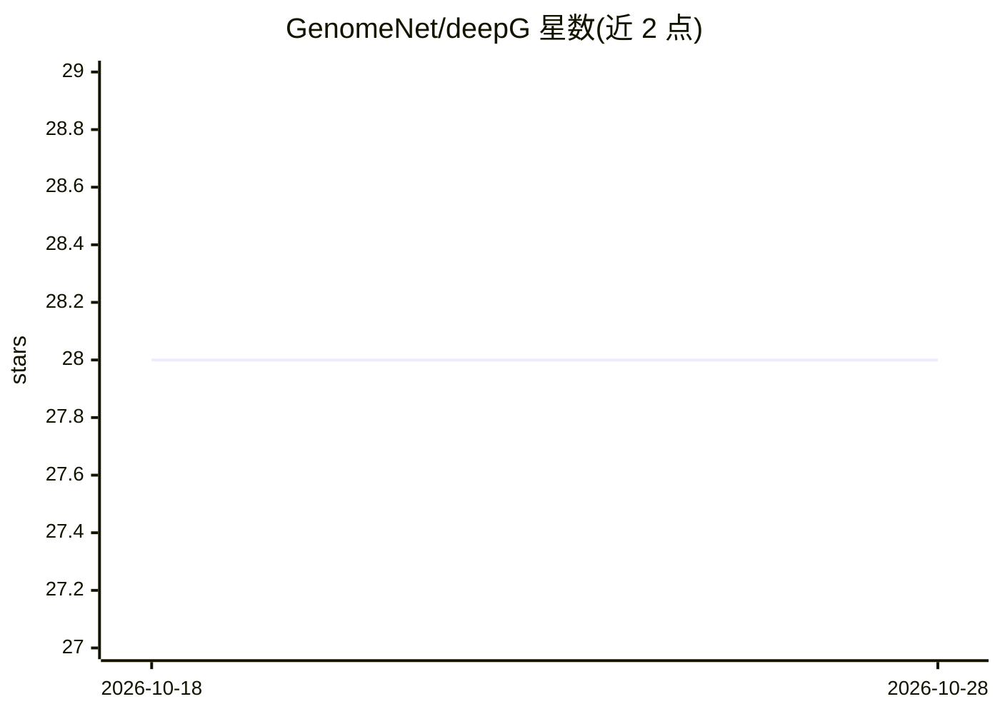

# GenomeNet/deepG

⭐ 28 · R · 推送 2025-11-18 · [GitHub](https://github.com/GenomeNet/deepG) · [官网](https://deepg.de) · 组织维护

**面向基因组数据的 R 深度学习工具箱**

DeepG 是用于在基因组数据集上训练和应用深度神经网络的 R 包，目标是加速序列分类、同源性检测等生物信息学工具的开发。它面向生物学家与进阶 AI 研究者，由 Helmholtz 感染研究中心 McHardy Lab、慕尼黑大学及哈佛公共卫生学院团队协作开发。功能覆盖数据处理（fasta/fastq 编码、歧义核苷酸处理）、单函数调用构建网络架构、自动训练管线、TensorBoard 训练可视化、模型评估与基于 Integrated Gradient 的可解释性分析。依赖 Python 版 TensorFlow，通过 GitHub 以 devtools 安装。

## 筛选速览

| 维度 | 判定 | 备注 |
|---|---|---|
| AI 角色 | `ai-native` | 本体是模型或模型工具 |
| 许可风险 | `none` | — |
| 部署形态 | `None` |  |
| 模型依赖 | — | README 未给出锁定关系 |
| 硬件要求 | — | 无带数字的原话,不猜 |
| 安装摩擦 | `low` | 无编译、无系统依赖或容器化 |
| 成熟度 | — | 结构信号不足 |

## 能力要点

- fasta/fastq 多种编码方式（one-hot、coverage、quality score）
- 单函数调用创建网络架构，支持自定义 loss 与 metric
- 自动构建模型/数据训练管线
- Integrated Gradient 模型可解释性可视化

## 适用场景

- 对基因组序列做深度学习分类或同源性检测
- 处理大规模 fasta/fastq 文件集合并训练模型
- 分析模型预测与输入序列之间的关系

## 场景标签

`模型训练` · 领域:训练与推理

## 证据(README 行号)

> L6: The goal of the package is to speed up the development of
> L19: The package offers several functions to create, train and evaluate

## 星数曲线

2026-10-18 28 → 2026-10-28 28（+0）

---
*卡片 v1 · prompt 1.4 · 生成 2026-10-26 · 置信度 high · 依据 README sha `04c1e6ed96d2` · [字段定义](../../DATASET.md)*
