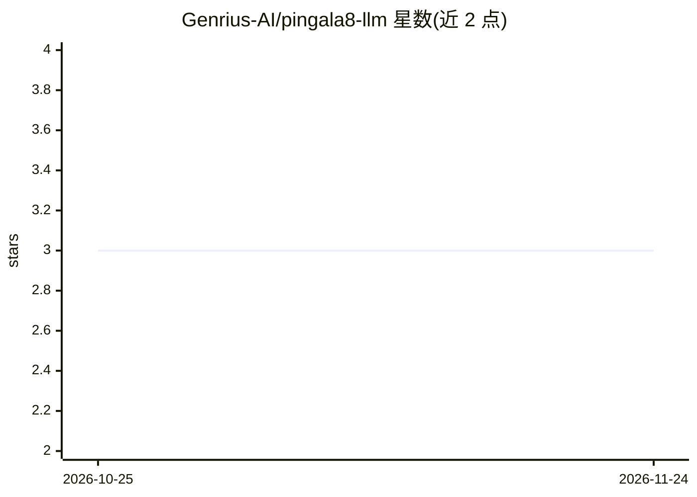

# Genrius-AI/pingala8-llm

⭐ 3 · Python · Apache-2.0 · 推送 2026-11-01 · [GitHub](https://github.com/Genrius-AI/pingala8-llm) · [官网](https://genrius-ai.github.io/pingala8-llm/) · 组织维护

**2-bit 无重训 LLM 压缩格式：省 VRAM 的 llama.cpp 补丁与模型文件**

Pingala-8 是面向 llama.cpp 的 2-bit 量化格式，基于小状态格状编码（Ungerboeck 格状码 + Hadamard 旋转 + QuIP LDLQ），将 Qwen3/Llama 模型文件缩小约 85%（如 Qwen3-4B 从 8.05 GB 到 1.24 GB），无需重训练。提供打了 CUDA 补丁的一键运行包（Windows/Linux）、7 个 Hugging Face 模型文件及论文复现脚本。限制：需 RTX 30/40/50 系列 GPU，stock llama.cpp、Ollama、LM Studio 无法加载其文件，长 prompt 处理较慢，仅 CUDA 路径。

## 筛选速览

| 维度 | 判定 | 备注 |
|---|---|---|
| AI 角色 | `ai-native` | 本体是模型或模型工具 |
| 许可风险 | `permissive` | Apache-2.0 |
| 部署形态 | `desktop` | 安装包/桌面程序 |
| 模型依赖 | local-ok | 支持本地模型 |
| 硬件要求 | — | 无带数字的原话,不猜 |
| 安装摩擦 | `medium` | 含编译或系统依赖之一 |
| 成熟度 | — | 结构信号不足 |

## 能力要点

- 无重训练的 2-bit 格式，Qwen3-4B 文件从 8.05 GB 压至 1.24 GB
- 附带 CUDA 补丁的 llama.cpp 一键运行包，Windows 双击 bat、Linux 一行脚本安装
- 7 个模型在 Hugging Face 发布，含论文、构建脚本与复现日志
- 公开论文（DOI）与逐步复现协议（perplexity 预期值与日志行号对照）

## 适用场景

- 在显存有限的 NVIDIA GPU 上本地运行 4B-8B 级 LLM
- 复现论文中的量化模型 perplexity 评测
- 为 Qwen3/Llama 系列生成 2-bit GGUF 压缩文件

## 场景标签

`模型量化` `推理引擎` · 领域:训练与推理

## 证据(README 行号)

> L10: **We make LLMs 85% smaller, with no retraining.** Pingala-8 is a 2-bit format for llama.cpp: Qwen3-4B goes from 8.0
> L43: Needs an NVIDIA RTX 30, 40 or 50 series GPU and a recent driver. No Python, no build. Stock llama.cpp, Ollama and L

## 星数曲线

2026-10-25 3 → 2026-11-24 3（+0）

---
*卡片 v1 · prompt 1.4 · 生成 2026-11-22 · 置信度 high · 依据 README sha `7af5ac39c84a` · [字段定义](../../DATASET.md)*
