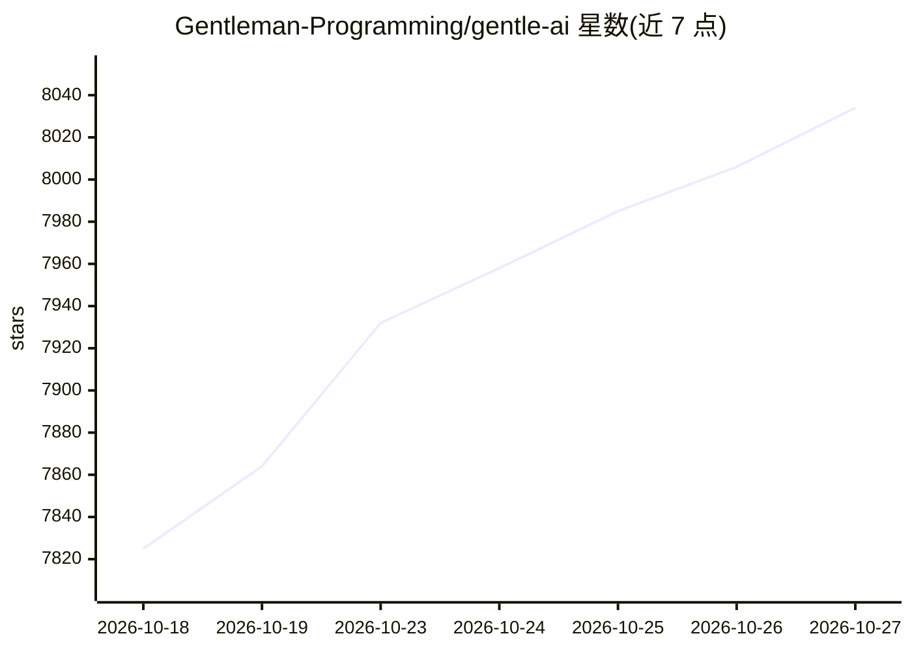

# Gentleman-Programming/gentle-ai

⭐ 8,034 · Go · MIT · 推送 2026-10-26 · [GitHub](https://github.com/Gentleman-Programming/gentle-ai) · [官网](https://gentlemanprogramming.com/) · 组织维护

**为已有 AI 编程 agent 配置记忆、工作流与审查的开源环境**

面向已使用 Claude Code、Cursor、Codex、Pi 等 17 种编码 agent 的开发者：Gentle-AI 不安装 agent，而是为其提供共享配置，包括 Engram 持久项目记忆、Organic Driven Development（ODD）工作流、Receipt-Driven Development（RDD）审查、技能库、MCP 服务器、可选 persona。gentle-ai 二进制从磁盘文件读取变更状态并返回唯一有效的下一步（Working/Checking/Ready/Needs your decision）。通过 Homebrew 等安装，配置写入前自动快照备份；各集成沿用 agent 原生能力，功能可用性因 agent 而异。

## 筛选速览

| 维度 | 判定 | 备注 |
|---|---|---|
| AI 角色 | `ai-ecosystem` | LLM/agent 周边工具 |
| 许可风险 | `permissive` | MIT |
| 部署形态 | `None` |  |
| 模型依赖 | — | README 未给出锁定关系 |
| 硬件要求 | — | 无带数字的原话,不猜 |
| 安装摩擦 | `low` | 无编译、无系统依赖或容器化 |
| 成熟度 | — | 结构信号不足 |

## 能力要点

- Engram 持久项目记忆，跨会话与上下文压缩保留决策
- ODD 工作流按理解/风险/可恢复性决定任务与委派路径
- RDD 审查默认开启：冻结候选后按风险分层执行，最多一次有界修正
- gentle-ai 二进制确定性地返回四态工作流转换；17 种 agent 集成

## 适用场景

- 让常用的编码 agent 记住项目决策，不必每个会话重新解释
- 为高风险变更加入有界的独立审查与证据记录
- 统一多个编码 agent 的共享工作流与配置

## 场景标签

`代码审查` `Agent 记忆` · 领域:Agent 开发

## 证据(README 行号)

> L40:  WORKS WITH THE AGENT YOU ALREADY HAVE
> L154: Gentle-AI brings its shared workflow to Pi, OpenCode, Claude Code, Codex, and thirteen more agents. Each integrati
> L192: Then use your agent normally. Your configs are snapshotted before every write, and **Gentle-AI never installs an A

## 星数曲线

2026-10-18 7,825 → 2026-10-27 8,034（+209）

---
*卡片 v1 · prompt 1.4 · 生成 2026-10-20 · 置信度 high · 依据 README sha `60700c4a7425` · [字段定义](../../DATASET.md)*
