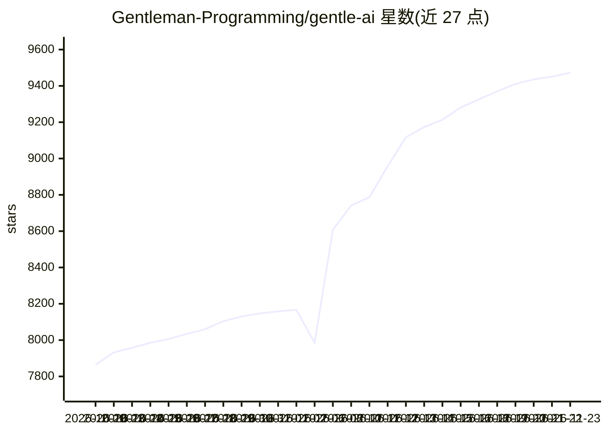

# Gentleman-Programming/gentle-ai

⭐ 9,472 · Go · MIT · 推送 2026-11-22 · [GitHub](https://github.com/Gentleman-Programming/gentle-ai) · [官网](https://gentlemanprogramming.com/) · 组织维护

**为已有 AI 编码 agent 统一配置记忆、工作流与审查**

Gentle-AI 是一个对现有 AI 编码 agent 进行统一配置的工具：为 Pi、OpenCode、Claude Code、Codex、Cursor 等 17 个 agent 写入原生配置，提供 Engram 项目记忆层、ODD 工作流、按风险分层的 RDD 审查、技能库、Context7 MCP、CodeGraph 与安全拒绝列表等组件。状态由 gentle-ai 二进制从磁盘文件读取并确定性返回四种公开状态之一；RDD 审查默认开启，可用命令关闭。MIT 许可，通过 Homebrew、go 或安装脚本安装。

## 筛选速览

| 维度 | 判定 | 备注 |
|---|---|---|
| AI 角色 | `ai-ecosystem` | LLM/agent 周边工具 |
| 许可风险 | `permissive` | MIT |
| 部署形态 | `library` | 以包/库形式分发 |
| 模型依赖 | — | README 未给出锁定关系 |
| 硬件要求 | — | 无带数字的原话,不猜 |
| 安装摩擦 | `low` | 无编译、无系统依赖或容器化 |
| 成熟度 | — | 结构信号不足 |

## 能力要点

- 为 17 个编码 agent 写入各自原生配置，无 agent 锁定
- Engram 记忆层跨会话保存项目决策与上下文
- gentle-ai 二进制从磁盘状态确定性返回下一个有效转移（Working/Checking/Ready/Needs your decision）
- 安全拒绝列表阻断 ~/.ssh、.env 与凭据文件，每次写入前快照配置备份

## 适用场景

- 为团队内多种 AI 编码 agent 统一配置工作流与记忆
- 让 agent 跨会话记住项目决策而不必每天重讲
- 对高风险变更执行分层的自动化审查流程

## 场景标签

`代码审查` `Agent 记忆` · 领域:Agent 开发

## 证据(README 行号)

> L5:  The deterministic engineering environment for the AI agent you already use.
> L169: Gentle-AI brings its shared workflow to Pi, OpenCode, Claude Code, Codex, and thirteen more agents. Each integrati

## 星数曲线

2026-10-20 7,864 → 2026-11-23 9,472（+1,608）

---
*卡片 v1 · prompt 1.4 · 生成 2026-11-22 · 置信度 high · 依据 README sha `5a8b0e61ec25` · [字段定义](../../DATASET.md)*
