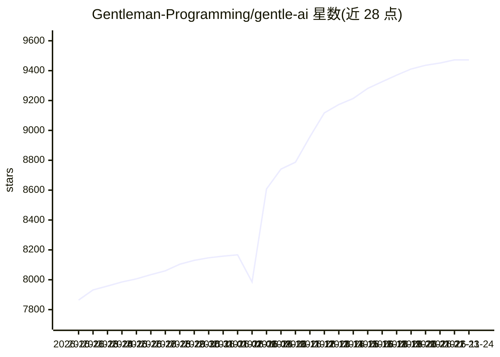

# Gentleman-Programming/gentle-ai

⭐ 9,472 · Go · MIT · 推送 2026-11-22 · [GitHub](https://github.com/Gentleman-Programming/gentle-ai) · [官网](https://gentlemanprogramming.com/) · 组织维护

**为已有 AI 编码 agent 配置记忆、工作流与审查的开源工具**

一个配置工具（MIT，Go 实现），为用户已使用的 17+ 个编码 agent（Claude Code、Cursor、Codex 等）统一配置持久记忆（Engram）、ODD 工作流、技能库、MCP 服务器、personas 与可选的有界审查（RDD）。通过读取磁盘文件状态输出四个固定状态（Working/Checking/Ready/Needs your decision），配置写入前自动快照备份，并带安全拒绝列表与 `gentle-ai doctor` 健康检查。提供 brew、go install 与安装脚本三种安装途径。

## 筛选速览

| 维度 | 判定 | 备注 |
|---|---|---|
| AI 角色 | `ai-ecosystem` | LLM/agent 周边工具 |
| 许可风险 | `permissive` | MIT |
| 部署形态 | `library` | 以包/库形式分发 |
| 模型依赖 | — | README 未给出锁定关系 |
| 硬件要求 | — | 无带数字的原话,不猜 |
| 安装摩擦 | `low` | 无编译、无系统依赖或容器化 |
| 成熟度 | — | 结构信号不足 |

## 能力要点

- Engram 持久记忆层：跨会话保存决策并在后续会话先读记忆
- ODD 工作流：小改动内联执行，大改动生成可恢复的特性文档
- RDD 有界审查：候选冻结后按风险分级选择审查深度，默认开启可关闭
- 统一配置 17 个编码 agent，使用各 agent 原生能力

## 适用场景

- 让 Claude Code/Cursor 等 agent 跨会话记住项目决策
- 为编码 agent 增加带证据的变更审查流程
- 在一个团队里统一多个 agent 的工作流配置

## 场景标签

`代码审查` · 领域:编码与开发

## 证据(README 行号)

> L5:  The deterministic engineering environment for the AI agent you already use.
> L169: Gentle-AI brings its shared workflow to Pi, OpenCode, Claude Code, Codex, and thirteen more agents. Each integrati
> L171: **Docs →**

## 星数曲线

2026-10-21 7,864 → 2026-11-24 9,472（+1,608）

---
*卡片 v1 · prompt 1.4 · 生成 2026-11-23 · 置信度 high · 依据 README sha `1ef79d86d3ab` · [字段定义](../../DATASET.md)*
