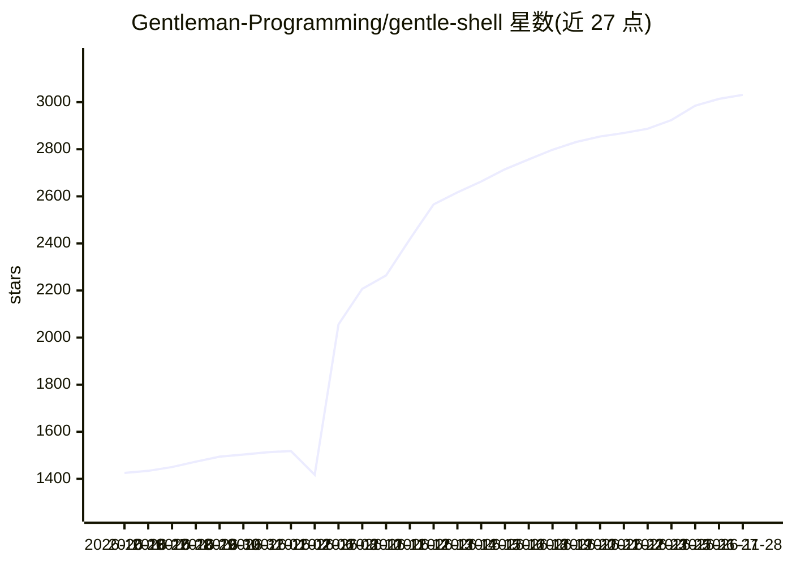

# Gentleman-Programming/gentle-shell

⭐ 3,031 · TypeScript · MIT · 推送 2026-11-27 · [GitHub](https://github.com/Gentleman-Programming/gentle-shell) · [官网](https://gentle-ai.gentlemanprogramming.com/) · 组织维护 · 中文 README

**面向 Pi 的 AI 编码工作区终端：并行 agent、任务、diff 与记忆一体化**

gentle-shell 是一个 Pi-native 的终端工作区，将编码 agent 编排、实时变更与运行状态、Git diff 视图、持久记忆（Engram）与权限控制整合在一个界面中。核心机制包括：el Gentleman 六步工作流（意图→范围→执行→证据）、ODD（Organic Driven Development）七步流程、按比例路由的 Focused agents（只读探索者、并行写入者、独立验证者），以及原生 review 与本地 web 视图 Gentle Tower。README 同时给出与 Codex CLI 对比的内部基准数据（n=1，单次运行）。通过 npm 安装，MIT 许可。

## 筛选速览

| 维度 | 判定 | 备注 |
|---|---|---|
| AI 角色 | `ai-ecosystem` | LLM/agent 周边工具 |
| 许可风险 | `permissive` | MIT |
| 部署形态 | `desktop` | 安装包/桌面程序 |
| 模型依赖 | — | README 未给出锁定关系 |
| 硬件要求 | — | 无带数字的原话,不猜 |
| 安装摩擦 | `low` | 无编译、无系统依赖或容器化 |
| 成熟度 | — | 结构信号不足 |

## 能力要点

- 并行子 agent 编排：只读探索者、并行写入者、独立验证者，父会话负责最终范围与决策
- Gentle Changes 聚合主仓库与子 agent worktree 的未提交变更，懒加载 diff 视图
- Gentle Tower 本地 web 视图：每个会话一层楼，仅监听 127.0.0.1 并带一次性 token
- ODD 特性文档逐字引用规格，跨会话经 Engram 记忆恢复进度

## 适用场景

- 在终端里同时管理多个编码 agent 的任务与权限
- 审查 agent 留在多个 worktree 中的未提交改动
- 长任务中断后通过特性文档与记忆恢复工作进度
- 通过浏览器查看各会话的进行状态与任务清单

## 场景标签

`编码 Agent` `代码审查` · 领域:编码与开发

## 证据(README 行号)

> L21:  Your terminal can run an agent. Your workspace should help you lead it. gentle-shell is your coding agent, bringin
> L78: Bring in help without losing the thread. Focused package-owned Pi agents can map a codebase, implement a bounded ch
> L121: A bare terminal answers "what is the agent doing?" only with scrollback. gentle-shell turns your Pi session into a

## 星数曲线

2026-10-26 1,425 → 2026-11-28 3,031（+1,606）

---
*卡片 v1 · prompt 1.4 · 生成 2026-11-24 · 置信度 high · 依据 README sha `eb962ae1f683` · [字段定义](../../DATASET.md)*
