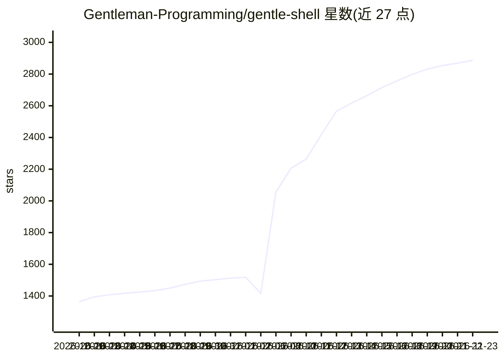

# Gentleman-Programming/gentle-shell

⭐ 2,887 · TypeScript · MIT · 推送 2026-11-22 · [GitHub](https://github.com/Gentleman-Programming/gentle-shell) · [官网](https://gentle-ai.gentlemanprogramming.com/) · 组织维护 · 中文 README

**为 Pi 终端打造的编码 Agent 工作区：任务、diff、记忆一体管理**

gentle-shell 是面向 Pi 的终端工作区，把编码 Agent 的并行子代理、实时任务、Git 变更查看、持久记忆（Engram）与权限控制整合到一个界面。核心机制包括：ODD 七步工作流（授权、探索、分类、跟踪、实现、收尾）、按理解/风险/可恢复性做比例化路由（内联、只读探索者、并行写入者、独立验证者），以及针对高风险项的独立审查路径。另有 Gentle Tower 本地 Web 视图（仅监听 127.0.0.1）展示各会话状态。通过 npm 分发，MIT 许可，需配合 Pi 运行。

## 筛选速览

| 维度 | 判定 | 备注 |
|---|---|---|
| AI 角色 | `ai-native` | 本体是模型或模型工具 |
| 许可风险 | `permissive` | MIT |
| 部署形态 | `desktop` | 安装包/桌面程序 |
| 模型依赖 | — | README 未给出锁定关系 |
| 硬件要求 | — | 无带数字的原话,不猜 |
| 安装摩擦 | `low` | 无编译、无系统依赖或容器化 |
| 成熟度 | — | 结构信号不足 |

## 能力要点

- 比例化路由：内联/探索者/并行写入者/独立验证者按规则分派
- Gentle Changes 汇总主仓库与子代理 worktree 的未提交变更
- Engram 持久记忆使特性文档跨会话恢复
- Gentle Tower 本地 Web 视图，仅绑定 127.0.0.1 并带令牌

## 适用场景

- 在终端中并行运行多个编码代理并追踪各自改动
- 审查代理产出的精确 diff 后再决定提交
- 长任务中断后从特性文档恢复进度

## 场景标签

`编码 Agent` · 领域:编码与开发

## 证据(README 行号)

> L21:  Your terminal can run an agent. Your workspace should help you lead it. gentle-shell is your coding agent, bringin
> L121: A bare terminal answers "what is the agent doing?" only with scrollback. gentle-shell turns your Pi session into a

## 星数曲线

2026-10-20 1,364 → 2026-11-23 2,887（+1,523）

---
*卡片 v1 · prompt 1.4 · 生成 2026-11-23 · 置信度 mid · 依据 README sha `aa86d9d9ac63` · [字段定义](../../DATASET.md)*
