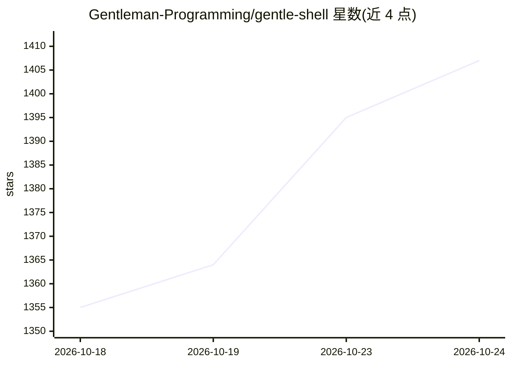

# Gentleman-Programming/gentle-shell

⭐ 1,407 · TypeScript · MIT · 推送 2026-10-23 · [GitHub](https://github.com/Gentleman-Programming/gentle-shell) · [官网](https://gentle-ai.gentlemanprogramming.com/) · 个人维护

**面向 Pi 的编码代理工作台：编排、审查与变更视图**

基于 Pi 构建的编码代理工作区（workspace）与 npm 包：将 el Gentleman 工作流、Organic Driven Development（ODD）七步流程、按理由委派的聚焦子代理（只读探索者/并行写者/独立验证者）、风险分级的原生审查与权限模式整合在终端工作台中。提供会话内 Git 变更查看（Gentle Changes）、子代理实时视图、命名配置文件与模型路由、命令面板等界面机制。提供 macOS/Windows/Linux 双击安装器与浏览器向导安装方式，跨会话功能依赖 Engram 记忆组件。

## 筛选速览

| 维度 | 判定 | 备注 |
|---|---|---|
| AI 角色 | `ai-ecosystem` | LLM/agent 周边工具 |
| 许可风险 | `permissive` | MIT |
| 部署形态 | `desktop` | 安装包/桌面程序 |
| 模型依赖 | — | README 未给出锁定关系 |
| 硬件要求 | — | 无带数字的原话,不猜 |
| 安装摩擦 | `low` | 无编译、无系统依赖或容器化 |
| 成熟度 | — | 结构信号不足 |

## 能力要点

- 按理解/风险/可恢复性路由任务：内联、只读探索者、并行写者或独立验证者
- 原生审查针对冻结候选变更返回风险分级证据，RDD 可用命令关闭
- Gentle Changes 显示会话仓库及子代理 worktree 的未提交变更
- 命名 Profile 原子路由 orchestrator 与打包/审查角色的模型
- 提供双击安装器与浏览器安装向导（macOS/Windows/Linux）

## 适用场景

- 在终端里以工作区方式领导和监控编码代理的工作
- 让子代理并行实现并独立验证高风险变更
- 跨会话恢复功能文档与任务进度

## 场景标签

`编码 Agent` `代码审查` `多智能体` · 领域:Agent 开发

## 证据(README 行号)

> L21:  Your terminal can run an agent. Your workspace should help you lead it. gentle-shell is your coding agent, bringin
> L75: Bring in help without losing the thread. Focused package-owned Pi agents can map a codebase, implement a bounded ch
> L122: A bare terminal answers "what is the agent doing?" only with scrollback. gentle-shell turns your Pi session into a

## 星数曲线

2026-10-18 1,355 → 2026-10-24 1,407（+52）

---
*卡片 v1 · prompt 1.4 · 生成 2026-10-21 · 置信度 mid · 依据 README sha `9ef1731c721c` · [字段定义](../../DATASET.md)*
