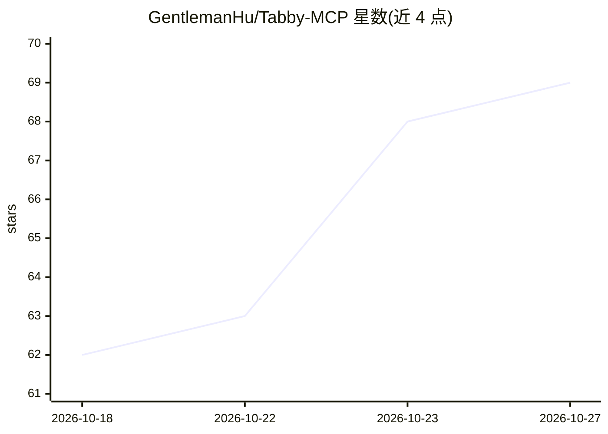

# GentlemanHu/Tabby-MCP

⭐ 69 · TypeScript · MIT · 推送 2026-10-09 · [GitHub](https://github.com/GentlemanHu/Tabby-MCP) · [官网](https://www.npmjs.com/package/tabby-mcp-server) · 个人维护 · 中文 README

**Tabby 终端的 MCP 服务器插件：让 AI 助手控制终端（36 个工具）**

Tabby Terminal 的插件，内置 MCP 服务器，向 AI 客户端提供 36 个工具，覆盖命令执行与会话管理、标签页与分屏操作、SSH 快速连接，以及依赖 tabby-ssh 的 SFTP 文件操作。支持 Streamable HTTP 与 STDIO 两种接入模式，可对接 Claude Desktop、Cursor、VS Code 等客户端。安全机制包括 Pair Programming 确认对话框（两分钟超时自动拒绝）、默认仅绑定 127.0.0.1、Host/Origin 校验。项目自述 95% 以上由 AI 生成，仅在 macOS 上经过测试，Windows/Linux 未验证。

## 筛选速览

| 维度 | 判定 | 备注 |
|---|---|---|
| AI 角色 | `ai-ecosystem` | LLM/agent 周边工具 |
| 许可风险 | `permissive` | MIT |
| 部署形态 | `library` | 以包/库形式分发 |
| 模型依赖 | — | README 未给出锁定关系 |
| 硬件要求 | — | 无带数字的原话,不猜 |
| 安装摩擦 | `low` | 无编译、无系统依赖或容器化 |
| 成熟度 | — | 结构信号不足 |

## 能力要点

- 36 个 MCP 工具：终端控制 9、标签页管理 11、配置管理 4、SFTP 12
- 支持 Streamable HTTP（2025-03-26）与 STDIO 桥接两种接入方式
- Pair Programming 确认对话框与默认回环绑定等安全机制
- 支持 SSH 键盘交互认证响应提交（含 MFA/TOTP）

## 适用场景

- 让 AI 编程助手在 Tabby 终端中执行命令并读取输出
- 通过 AI 客户端管理远程主机的 SFTP 文件
- 以对话方式控制终端标签页、分屏与 SSH 连接

## 场景标签

`GUI 自动化` · 领域:效率与自动化

## 证据(README 行号)

> L19: > 🚀 **Tabby-MCP** is a powerful plugin for Tabby Terminal, bridging the gap between AI agents and your terminal env
> L131: ### Streamable HTTP Mode (Cursor / Windsurf / Cline)

## 星数曲线

2026-10-18 62 → 2026-10-27 69（+7）

---
*卡片 v1 · prompt 1.4 · 生成 2026-10-24 · 置信度 high · 依据 README sha `405ca855c6e2` · [字段定义](../../DATASET.md)*
