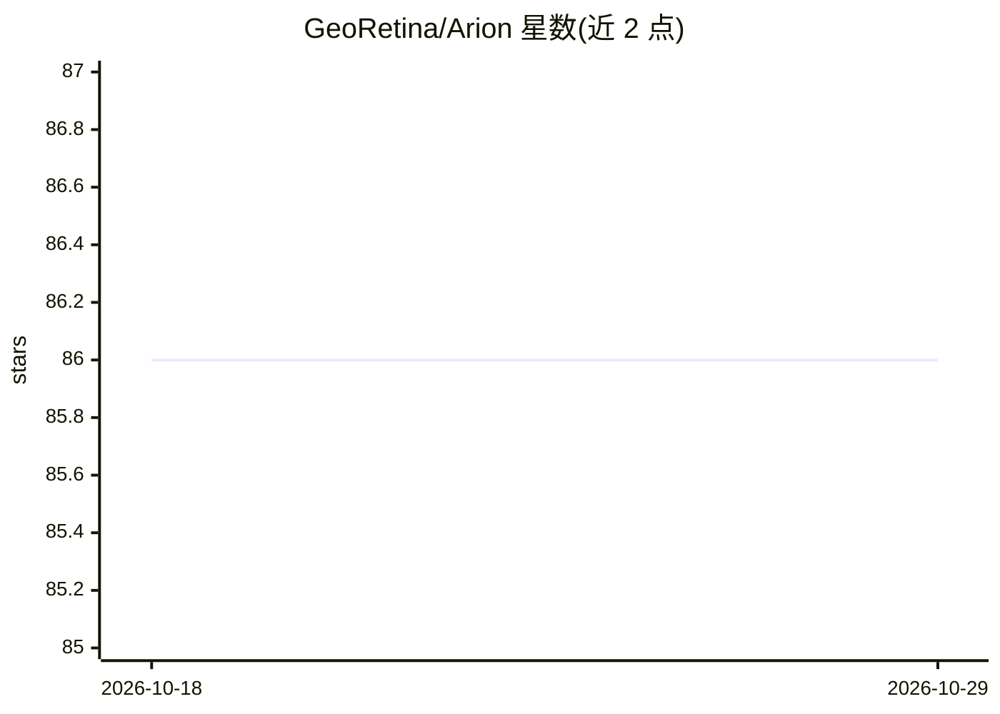

# GeoRetina/Arion

⭐ 86 · TypeScript · GPL-3.0 · 推送 2026-04-05 · [GitHub](https://github.com/GeoRetina/Arion) · [官网](https://www.georetina.com) · 组织维护

**面向 GIS 用户的对话式地理空间 AI 分析桌面应用**

由 GeoRetina Inc. 开发的跨平台桌面应用（Electron + React/TypeScript），通过聊天界面调用本地或云端 LLM 完成地理空间查询与地图操作：内置地图工具（添加要素、缓冲区、视图控制），支持 MapLibre GL 地图可视化、用户自定义 MCP 服务器接入外部工具、PDF/DOCX/TXT 文档摄入本地向量库（PGlite + pgvector）做 RAG。支持 Ollama 配置本地模型。Agentic 工作流与插件系统为规划中功能。当前无预编译安装包，需 Node.js 22+ 从源码构建，Windows/macOS/Linux 构建各需平台编译工具，栅格处理依赖 GDAL（Windows 已捆绑）。GPL-3.0-or-later 许可。

## 筛选速览

| 维度 | 判定 | 备注 |
|---|---|---|
| AI 角色 | `ai-native` | 本体是模型或模型工具 |
| 许可风险 | `viral` | GPL-3.0 |
| 部署形态 | `desktop` | 安装包/桌面程序 |
| 模型依赖 | local-ok | 支持本地模型 |
| 硬件要求 | — | 无带数字的原话,不猜 |
| 安装摩擦 | `high` | 编译与系统依赖俱全 |
| 成熟度 | — | 结构信号不足 |

## 能力要点

- 聊天界面调用 LLM 执行地图操作与地理空间分析（OpenAI/Gemini/Azure/Anthropic/Ollama）
- 支持用户自定义 MCP 服务器扩展 agent 工具与数据源
- 文档摄入本地向量库（PGlite + pgvector）实现 RAG 问答
- SQLite/SpatiaLite 管理设置、聊天历史与插件配置

## 适用场景

- 用自然语言对地图数据进行查询与空间分析
- 在知识库中检索自己的地理相关文档辅助分析
- 通过 MCP 服务器把自建 Python/TypeScript 工具接入 agent

## 场景标签

`数据分析` `文档问答` · 领域:效率与自动化

## 证据(README 行号)

> L11: Arion is a **cross-platform desktop application** designed for advanced geospatial analysis and agentic workflows. 
> L25: - **Interactive Chat Interface:** Communicate with LLMs for geospatial queries, analysis, and task automation. Supp
> L30: - **Knowledge Base Integration:** Ingest documents (PDF, DOCX, TXT) into a local vector store (PGlite with pgvector

## 星数曲线

2026-10-18 86 → 2026-10-29 86（+0）

---
*卡片 v1 · prompt 1.4 · 生成 2026-10-24 · 置信度 high · 依据 README sha `8885586e4da1` · [字段定义](../../DATASET.md)*
