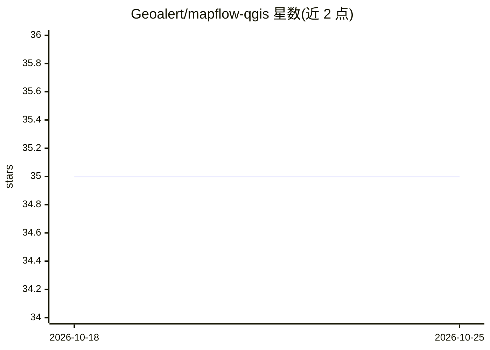

# Geoalert/mapflow-qgis

⭐ 35 · Python · 推送 2026-09-23 · [GitHub](https://github.com/Geoalert/mapflow-qgis) · [官网](https://docs.mapflow.ai/api/qgis_mapflow.html) · 组织维护

**QGIS 插件：在 QGIS 内调用 Mapflow 从卫星影像提取地物**

Geoalert 官方的 QGIS 插件，作为 Mapflow AI 服务的客户端：用户在 QGIS 中指定要提取的地物类型（建筑轮廓含高度、森林、工地、道路）、区域与影像源，由云端 Mapflow 模型完成检测并输出矢量要素。影像源支持本地 GeoTIFF 上传、Mapbox Satellite 等瓦片服务、XYZ/WMS 链接及 Mapflow 影像目录。安装通过 QGIS 官方插件仓库完成；仓库另含基于 Docker 的自动化测试与 ruff/pyright 静态检查流程，CI 仅覆盖 Linux + QGIS 3.28 LTR。

## 筛选速览

| 维度 | 判定 | 备注 |
|---|---|---|
| AI 角色 | `ai-ecosystem` | LLM/agent 周边工具 |
| 许可风险 | `none` | — |
| 部署形态 | `library` | 以包/库形式分发 |
| 模型依赖 | — | README 未给出锁定关系 |
| 硬件要求 | — | 无带数字的原话,不猜 |
| 安装摩擦 | `low` | 无编译、无系统依赖或容器化 |
| 成熟度 | — | 结构信号不足 |

## 能力要点

- 在 QGIS 内调用 Mapflow 服务检测建筑/森林/工地/道路等地物
- 支持本地 GeoTIFF、Mapbox Satellite、XYZ/WMS 等多种影像源
- 通过 QGIS 官方插件仓库安装（搜索 'Mapflow'）
- 测试在 qgis/qgis Docker 镜像内运行，无需宿主 QGIS

## 适用场景

- 在 QGIS 工作流中直接对卫星/航空影像做建筑物或道路提取
- 上传本地 GeoTIFF 或指定在线瓦片服务进行地物检测
- 批量从影像目录选取影像并处理

## 场景标签

`目标检测` · 领域:感知与多模态

## 证据(README 行号)

> L3: At Geoalert, we employ Artificial Intelligence (AI) and Machine Learning (ML) to detect and extract real-world objec
> L17: **Geoalert Mapflow plugin for QGIS**
> L20: The plugin can be found in the official QGIS plugin repository and can be installed by going to Plugins -> Manage a

## 星数曲线

2026-10-18 35 → 2026-10-25 35（+0）

---
*卡片 v1 · prompt 1.4 · 生成 2026-10-25 · 置信度 low · 依据 README sha `5aa8f6e273c4` · [字段定义](../../DATASET.md)*
