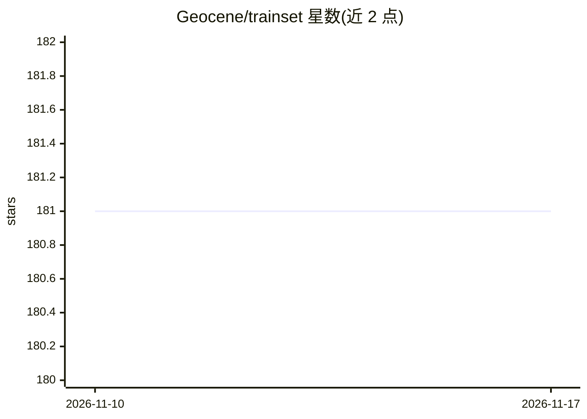

# Geocene/trainset

⭐ 181 · JavaScript · MIT · 推送 2026-11-09 · [GitHub](https://github.com/Geocene/trainset) · [官网](https://trainset.geocene.com/) · 组织维护

**给机器学习开发者的时间序列数据标注 Web 应用**

TRAINSET 是一个用于标注时间序列数据的图形化 Web 应用：上传多条时间序列，用刷选方式给数据点应用一个或多个标签，并可导出 CSV，用于构建机器学习训练集。提供托管版本，也可自行部署：基于 Vue 2/webpack 4，要求 Node.js 24 与 npm 11，支持 Heroku-26 stack 部署。开发由 NIH 清洁烹饪实施科学网络资助。

## 筛选速览

| 维度 | 判定 | 备注 |
|---|---|---|
| AI 角色 | `ai-ecosystem` | LLM/agent 周边工具 |
| 许可风险 | `permissive` | MIT |
| 部署形态 | `None` |  |
| 模型依赖 | — | README 未给出锁定关系 |
| 硬件要求 | — | 无带数字的原话,不猜 |
| 安装摩擦 | `low` | 无编译、无系统依赖或容器化 |
| 成熟度 | — | 结构信号不足 |

## 能力要点

- 上传多条时间序列并以刷选方式应用标签
- 上传 CSV、刷选标注、导出带标签 CSV 的完整流程
- 提供托管版本与 Heroku 部署说明（Node 24/npm 11）

## 适用场景

- 为时间序列分类任务构建带标签的训练数据
- 上传 CSV 后以刷选方式快速标注数据点并导出
- 不想自行部署时直接使用托管版本

## 场景标签

 · 领域:机器学习/数据标注工具

## 证据(README 行号)

> L3: TRAINSET is a graphical tool for labeling time series data. You can upload multiple series and apply one or many lab
> L22: Run `npm run build` before `npm test` or `npm start`. Commit `package.json` and `package-lock.json` together when c

## 星数曲线

2026-11-10 181 → 2026-11-17 181（+0）

---
*卡片 v1 · prompt 1.4 · 生成 2026-11-17 · 置信度 mid · 依据 README sha `7050f92fc82a` · [字段定义](../../DATASET.md)*
