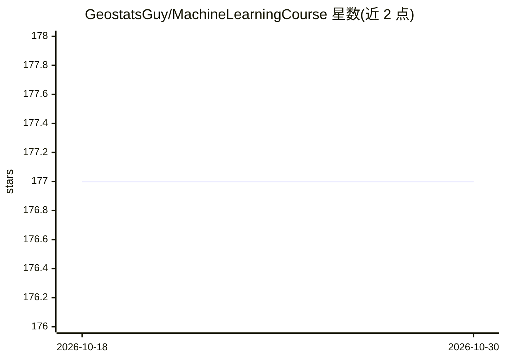

# GeostatsGuy/MachineLearningCourse

⭐ 177 · Jupyter Notebook · MIT · 推送 2025-12-02 · [GitHub](https://github.com/GeostatsGuy/MachineLearningCourse) · 组织维护

**地下资源机器学习研究生课程的学生项目作品集**

德州大学奥斯汀分校 Michael Pyrcz 教授的 Subsurface Machine Learning 研究生课程仓库，收录经学生授权的期末机器学习项目：以 Jupyter Notebook 形式编写的、面向地下资源建模的完整数据分析与机器学习工作流，按摘要、工作流步骤、图表、代码可读性、引用等标准评分。配套免费电子书、YouTube 讲座视频，并链接 PythonNumericalDemos、GeoDataSets、GeostatsPy 等教学用代码仓库。仓库本身不含可安装软件，内容按学期由助教协助维护。

## 筛选速览

| 维度 | 判定 | 备注 |
|---|---|---|
| AI 角色 | `ai-knowledge` | 知识聚合/清单类 |
| 许可风险 | `permissive` | MIT |
| 部署形态 | `None` |  |
| 模型依赖 | — | README 未给出锁定关系 |
| 硬件要求 | — | 无带数字的原话,不猜 |
| 安装摩擦 | `low` | 无编译、无系统依赖或容器化 |
| 成熟度 | — | 结构信号不足 |

## 能力要点

- 收录多届研究生的地下资源机器学习 Jupyter Notebook 工作流项目
- 配套免费电子书 Applied Machine Learning in Python 与 YouTube 讲座
- 给出明确的期末项目评分标准（摘要、步骤、图表、代码、引用等 8 项）

## 适用场景

- 学习地下资源建模领域的机器学习工作流范例
- 查找面向教学的 Python 数据分析与地质统计学代码演示
- 了解课程评分标准并参考往届学生项目形式

## 场景标签

`教程课程` · 领域:学习与行业

## 证据(README 行号)

> L5: This is the repository for my machine learning course's **final course projects**.
> L9: As part of this graduate level machine learning course, all students complete a machine learning final course projec
> L15: * **produce a comprehensive, concise, well-documented, machine learning workflow in a Jupyter Notebook** - an oppor

## 星数曲线

2026-10-18 177 → 2026-10-30 177（+0）

---
*卡片 v1 · prompt 1.4 · 生成 2026-10-22 · 置信度 high · 依据 README sha `8197294b4143` · [字段定义](../../DATASET.md)*
