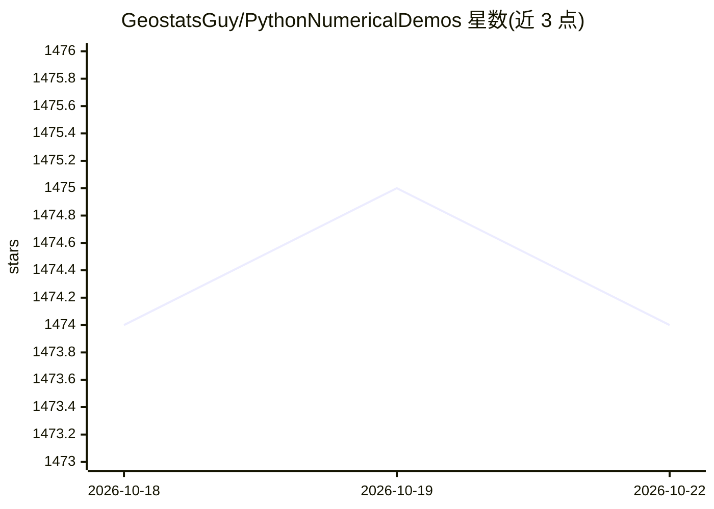

# GeostatsGuy/PythonNumericalDemos

⭐ 1,474 · Jupyter Notebook · MIT · 推送 2026-03-03 · [GitHub](https://github.com/GeostatsGuy/PythonNumericalDemos) · 组织维护

**面向教学的地理统计与机器学习 Python 演示代码集**

由德州大学奥斯汀分校 Michael Pyrcz 教授维护的教学仓库，收录配合其数据分析、地理统计、空间数据分析与机器学习课程的带注释 Python 工作流，用于课堂讲解、动手练习和示例复现。依赖 Python 3.7.10（因 GeostatsPy 依赖 Numpy 加速的 Numba）、MatPlotLib、NumPy、Pandas、SciPy、ipywidgets 与 GeostatsPy 等库，所需数据集在 GeoDataSets 仓库中提供。内容面向地下资源建模方向的学生与工程师。

## 筛选速览

| 维度 | 判定 | 备注 |
|---|---|---|
| AI 角色 | `ai-knowledge` | 知识聚合/清单类 |
| 许可风险 | `permissive` | MIT |
| 部署形态 | `None` |  |
| 模型依赖 | — | README 未给出锁定关系 |
| 硬件要求 | — | 无带数字的原话,不猜 |
| 安装摩擦 | `low` | 无编译、无系统依赖或容器化 |
| 成熟度 | — | 结构信号不足 |

## 能力要点

- 配合三门数据科学课程的带注释 Python 工作流
- 覆盖地理统计、空间数据分析与机器学习主题
- 配套 GeoDataSets 数据仓库与 GeostatsPy 包
- 有 Zenodo DOI 可引用

## 适用场景

- 学生学习地理统计与机器学习课程时复现课堂示例
- 工程师和地学人员自学空间数据分析工作流
- 教学者寻找可复用的地学数据科学演示素材

## 场景标签

`数据分析` `教程课程` · 领域:效率与自动化

## 证据(README 行号)

> L5: *To support my students in my **Data Analytics and Geostatistics**, **Spatial Data Analytics** and **Machine Learnin
> L32: I use these demonstrations for:

## 星数曲线

2026-10-18 1,474 → 2026-10-22 1,474（+0）

---
*卡片 v1 · prompt 1.4 · 生成 2026-10-21 · 置信度 high · 依据 README sha `8b5103aa7cf3` · [字段定义](../../DATASET.md)*
