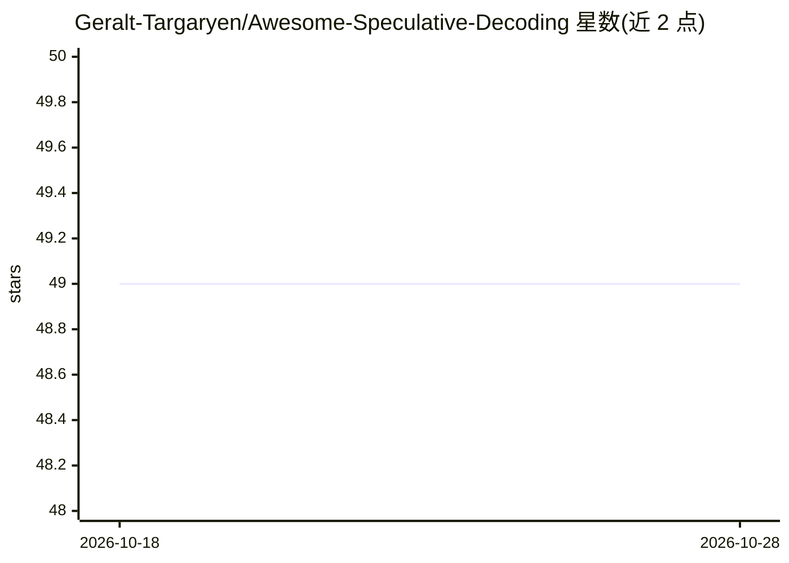

# Geralt-Targaryen/Awesome-Speculative-Decoding

⭐ 49 · 推送 2026-06-02 · [GitHub](https://github.com/Geralt-Targaryen/Awesome-Speculative-Decoding) · 个人维护

**Speculative Decoding 论文阅读清单（按会议与年份组织）**

面向 LLM 推理加速方向研究者的论文收录清单：按 ICLR/NeurIPS/EMNLP/ACL/ICML/NAACL 等会议及年份（2024-2026）组织，每条目给出论文标题、arXiv 时间戳与论文链接，覆盖 draft 模型训练、树形解码、多草稿采样、自投机解码、扩散模型投机采样等子方向，含 Main/Findings 与综述条目。仓库为纯文献列表，不含代码或安装步骤。

## 筛选速览

| 维度 | 判定 | 备注 |
|---|---|---|
| AI 角色 | `ai-knowledge` | 知识聚合/清单类 |
| 许可风险 | `none` | — |
| 部署形态 | `None` |  |
| 模型依赖 | — | README 未给出锁定关系 |
| 硬件要求 | — | 无带数字的原话,不猜 |
| 安装摩擦 | `low` | 无编译、无系统依赖或容器化 |
| 成熟度 | — | 结构信号不足 |

## 能力要点

- 按 8 个会议与年份分层的论文条目组织
- 条目含论文标题、时间戳与链接
- 覆盖树形/多草稿/自投机/扩散模型投机采样等子方向

## 适用场景

- 查找投机解码方向的已发表论文
- 按会议追踪该领域近年工作
- 为研究选型寻找 draft 模型与验证方法相关论文

## 场景标签

`精选清单` · 领域:学习与行业

## 证据(README 行号)

> L1: # Awesome-Speculative-Decoding
> L3: Reading list on speculative decoding.

## 星数曲线

2026-10-18 49 → 2026-10-28 49（+0）

---
*卡片 v1 · prompt 1.4 · 生成 2026-10-25 · 置信度 high · 依据 README sha `7e35e1f9e06d` · [字段定义](../../DATASET.md)*
