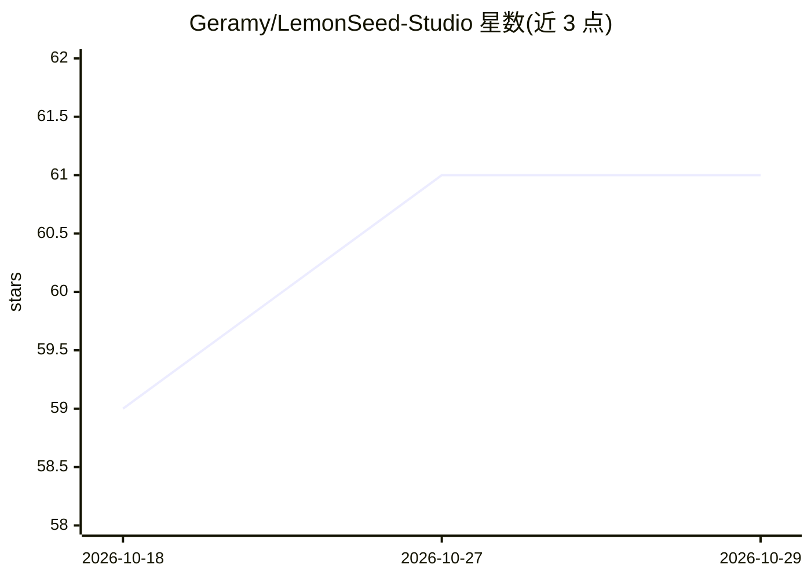

# Geramy/LemonSeed-Studio

⭐ 61 · C · NOASSERTION · 推送 2026-10-09 · [GitHub](https://github.com/Geramy/LemonSeed-Studio) · 个人维护

**在 iPad 上通过雷雷电外接 AMD GPU 运行本地 LLM 推理的 IDE**

单一 iPad 应用，捆绑三个组件：将未修改的上游 Linux amdgpu/amdkfd 驱动以 PCIDriverKit 扩展形式嵌入，驱动雷电盒子中的 AMD GPU；LemonSeed Engine 推理引擎通过 HSA 运行时与 HRX/Loom 在该 GPU 上执行推理；amdgpu_mtopg 提供实时 GPU 遥测。源码以子模块组织，需 git clone --recurse-submodules 获取，驱动部分首次构建时自行稀疏拉取锁定的 Linux 源码。原代码按 MIT 或 GPL-2.0-only 双许可提供。

## 筛选速览

| 维度 | 判定 | 备注 |
|---|---|---|
| AI 角色 | `ai-native` | 本体是模型或模型工具 |
| 许可风险 | `none` | NOASSERTION |
| 部署形态 | `None` |  |
| 模型依赖 | — | README 未给出锁定关系 |
| 硬件要求 | — | 无带数字的原话,不猜 |
| 安装摩擦 | `low` | 无编译、无系统依赖或容器化 |
| 成熟度 | — | 结构信号不足 |

## 能力要点

- 上游 Linux amdgpu/amdkfd 驱动以 PCIDriverKit 扩展嵌入
- 雷电外接 AMD GPU 上的 HSA/HRX/Loom 本地 LLM 推理
- amdgpu_mtopg 实时 GPU 遥测

## 适用场景

- 在 iPad 上编写代码并用外接 AMD GPU 做本地 LLM 推理
- 通过实时遥测监控外接 GPU 状态

## 场景标签

`推理引擎` · 领域:训练与推理

## 证据(README 行号)

> L5: An editor and IDE for iPad with on-device LLM inference on an AMD GPU.
> L12: - **LemonSeed Engine:** the inference engine,
> L13:  running on that GPU through its HSA runtime and HRX/Loom.

## 星数曲线

2026-10-18 59 → 2026-10-29 61（+2）

---
*卡片 v1 · prompt 1.4 · 生成 2026-10-24 · 置信度 high · 依据 README sha `6fbf253a80cf` · [字段定义](../../DATASET.md)*
