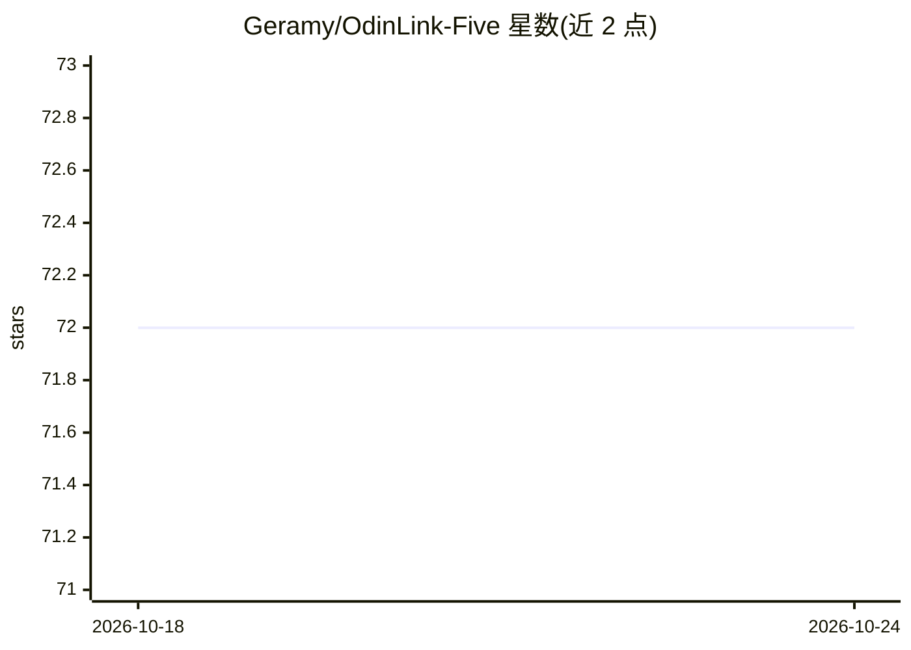

# Geramy/OdinLink-Five

⭐ 72 · C · 推送 2026-10-19 · [GitHub](https://github.com/Geramy/OdinLink-Five) · 个人维护

**把 Thunderbolt 5 变成 RDMA 互联的内核驱动与 NCCL/RCCL 插件**

面向 Linux 的内核驱动加用户态库组合：通过 NHI ring DMA 与 XDomain 握手，把 Thunderbolt 链路封装成标准 ibv_verbs API 与 RDMA 设备，使 NCCL、MPI、PyTorch DDP 等 verbs 感知应用不改代码即可跨机 GPU 通信；同时提供 NVIDIA NCCL 与 AMD RCCL 网络插件、CLI 测试工具、loopback/mock 无硬件测试路径。限制：rdma-core 插件在纯 OdinLink 主机上需 LD_PRELOAD 才能被 ibv_devinfo 发现；macOS 端 RDMA 内核扩展为 stub 不工作，仅支持发现。需自行编译安装内核模块。

## 筛选速览

| 维度 | 判定 | 备注 |
|---|---|---|
| AI 角色 | `ai-ecosystem` | LLM/agent 周边工具 |
| 许可风险 | `none` | — |
| 部署形态 | `None` |  |
| 模型依赖 | — | README 未给出锁定关系 |
| 硬件要求 | — | 无带数字的原话,不猜 |
| 安装摩擦 | `medium` | 含编译或系统依赖之一 |
| 成熟度 | — | 结构信号不足 |

## 能力要点

- 内核模块 + verbs provider + rdma-core 插件三层组件，暴露标准 ibv_* API
- NCCL（NVIDIA）与 RCCL（AMD）网络插件实现零拷贝 GPU 通信
- loopback=1 模块参数与 mock 库支持无电缆/无内核测试
- protocol=1 切换 Apple 协议 ID 实现 Mac↔Linux 发现

## 适用场景

- 用 TB5 线缆在两台机器间搭建低成本 GPU 集群互联
- Ubuntu 训练机上通过 PyTorch/NCCL 直接把 CUDA tensor 存到 Mac 内存
- 无硬件环境下用 loopback 验证 RDMA 应用代码

## 场景标签

 · 领域:高性能计算/GPU互联基础设施

## 证据(README 行号)

> L5: OdinLink turns a Thunderbolt cable into a high-speed RDMA interconnect between machines. It provides the full `ibv_*
> L28: |🟢|RCCL/NCCL net plugin|**Supported GPU path** — `librccl-net.so` / `libnccl-net-ODL_TB5.so` (see `docs/GPU.md`)|

## 星数曲线

2026-10-18 72 → 2026-10-24 72（+0）

---
*卡片 v1 · prompt 1.4 · 生成 2026-10-24 · 置信度 high · 依据 README sha `f1655b28ba24` · [字段定义](../../DATASET.md)*
