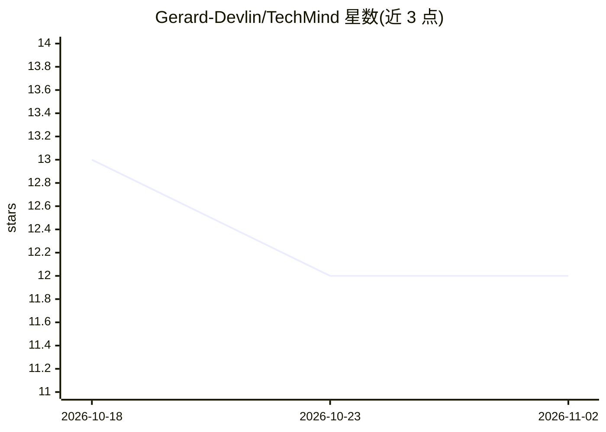

# Gerard-Devlin/TechMind

⭐ 12 · CSS · MIT · 推送 2026-10-27 · [GitHub](https://github.com/Gerard-Devlin/TechMind) · [官网](https://gerard-devlin.github.io/TechMind/) · 个人维护

**面向 CS 初学者的技术学习笔记与资源博客，附 Ask AI 问答**

一个持续扩充的计算机科学与技术学习笔记集合，内容涵盖算法与数据结构、数字电路、LeetCode、机器学习等主题，通过清晰解释、实例与概念关联组织知识点。读者可浏览笔记、查看源码并提交反馈。站内提供 Ask AI 功能，读者在学习时可提问、澄清不熟悉的概念并检索相关资料。项目代码以 MIT 许可发布。

## 筛选速览

| 维度 | 判定 | 备注 |
|---|---|---|
| AI 角色 | `ai-knowledge` | 知识聚合/清单类 |
| 许可风险 | `permissive` | MIT |
| 部署形态 | `None` |  |
| 模型依赖 | — | README 未给出锁定关系 |
| 硬件要求 | — | 无带数字的原话,不猜 |
| 安装摩擦 | `low` | 无编译、无系统依赖或容器化 |
| 成熟度 | — | 结构信号不足 |

## 能力要点

- 计算机科学多主题学习笔记与资源集合
- Ask AI 支持学习中的提问、概念澄清与资料查找
- 以解释、实例与概念关联组织内容便于回顾

## 适用场景

- 初学计算机科学时查找各主题的入门讲解
- 学习过程中通过 AI 问答澄清概念
- 回顾算法、数字电路、机器学习等知识点

## 场景标签

`教程课程` · 领域:学习与行业

## 证据(README 行号)

> L15: TechMind is a growing collection of notes and learning resources on computer science and technology. It brings toge
> L21: With **Ask AI**, readers can ask questions as they study, clarify unfamiliar concepts, and find relevant material. 

## 星数曲线

2026-10-18 13 → 2026-11-02 12（-1）

---
*卡片 v1 · prompt 1.4 · 生成 2026-11-01 · 置信度 mid · 依据 README sha `96702bb1c560` · [字段定义](../../DATASET.md)*
