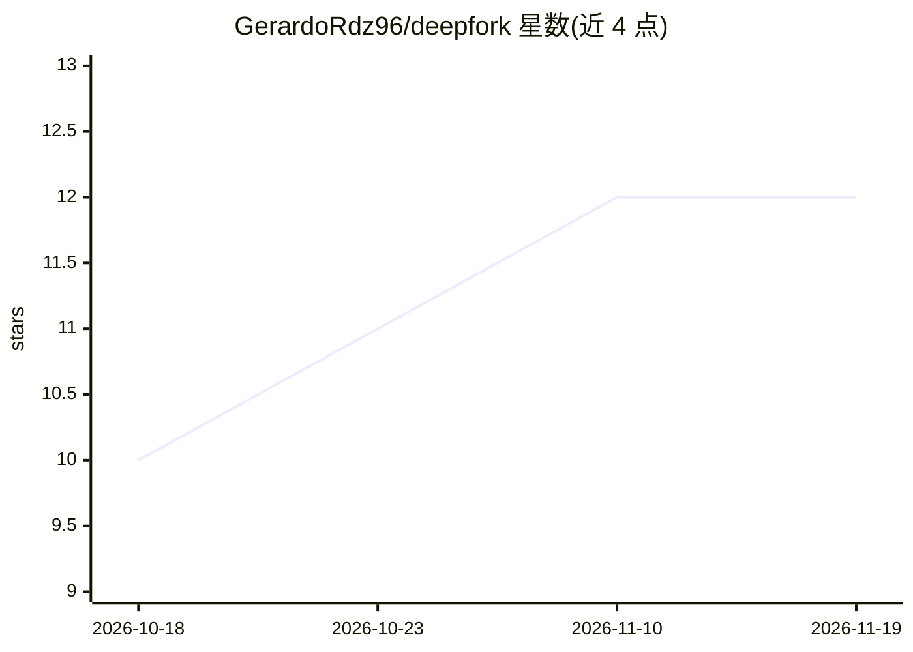

# GerardoRdz96/deepfork

⭐ 12 · MIT · 推送 2026-07-02 · [GitHub](https://github.com/GerardoRdz96/deepfork) · 个人维护

**面向开发者的 agent 技能：逆向开源仓库生成蓝图并洁净室重建**

DeepFork 是一个读取 skills 的 agent 技能，用于逆向解析开源仓库：先做 SPDX 许可检查，再基于知识图谱生成 UNDERSTANDING.md（3-7 个关键部件、端到端请求追踪、VERIFIED/INFERRED 标注）与 BLUEPRINT.md 行为规格，随后在关闭原始代码的洁净室流程中按规格重建用户定制版本，附带 ATTRIBUTION.md。默认适配 Claude Code，也可被读取 markdown 技能的其他 agent 运行；可选安装 graphify 提升分析能力，未安装则回退到手动仓库映射。

## 筛选速览

| 维度 | 判定 | 备注 |
|---|---|---|
| AI 角色 | `ai-ecosystem` | LLM/agent 周边工具 |
| 许可风险 | `permissive` | MIT |
| 部署形态 | `library` | 以包/库形式分发 |
| 模型依赖 | — | README 未给出锁定关系 |
| 硬件要求 | — | 无带数字的原话,不猜 |
| 安装摩擦 | `low` | 无编译、无系统依赖或容器化 |
| 成熟度 | — | 结构信号不足 |

## 能力要点

- 生成 UNDERSTANDING.md 与 BLUEPRINT.md 两类工件，声明逐条标注 VERIFIED/INFERRED
- 洁净室重建流程：只有行为描述跨越蓝图墙，不复制代码，附带 GPL/AGPL 提示
- Phase 0 许可门：SPDX 检查，拒绝重建无许可代码
- 可选 graphify 知识图谱引擎（本地 tree-sitter 代码分析）

## 适用场景

- 想用自己的技术栈实现某开源工具的定制版本而非直接 fork
- 快速理解大型仓库的核心机制而不通读全部代码
- 为遗留系统生成可据此重写的行为规格文档

## 场景标签

`编码 Agent` `知识图谱` · 领域:编码与开发

## 证据(README 行号)

> L8: Agent Skill
> L14: **DeepFork** is an agent skill that reverse-engineers any open-source repository into
> L30: Works with **Claude Code** (and any agent that reads skills):

## 星数曲线

2026-10-18 10 → 2026-11-19 12（+2）

---
*卡片 v1 · prompt 1.4 · 生成 2026-11-18 · 置信度 high · 依据 README sha `79efc0f061fc` · [字段定义](../../DATASET.md)*
