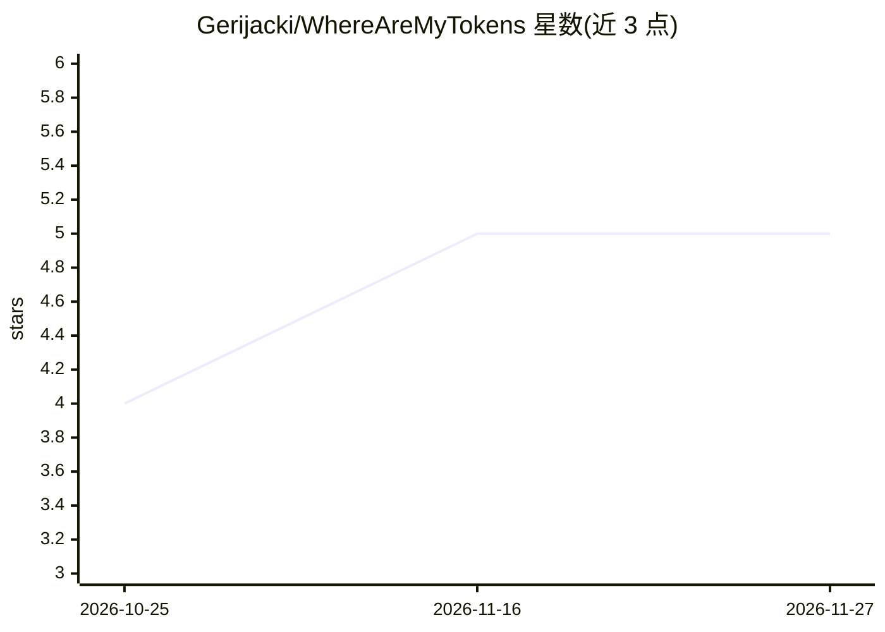

# Gerijacki/WhereAreMyTokens

⭐ 5 · Python · MIT · 推送 2026-11-22 · [GitHub](https://github.com/Gerijacki/WhereAreMyTokens) · 个人维护

**给 Claude Code 订阅用户的自托管用量成本分析面板**

自托管的分析服务：只读读取 Claude Code 写入 ~/.claude/projects 的本地会话转录，按模型与 token 类型计算 API 等效成本、估算订阅计划相对按量付费的价值，提供预算预警、5 小时窗口燃烧率、缓存重建归因、会话回放与 CSV/JSON 导出；内置 10 类浪费检测器并生成可粘贴的 skill/hook/CLAUDE.md 修复项。技术栈为 collector→PostgreSQL→FastAPI→React，一条 docker compose 命令启动，数据不出本机。

## 筛选速览

| 维度 | 判定 | 备注 |
|---|---|---|
| AI 角色 | `ai-ecosystem` | LLM/agent 周边工具 |
| 许可风险 | `permissive` | MIT |
| 部署形态 | `self-host` | docker 或自建部署 |
| 模型依赖 | — | README 未给出锁定关系 |
| 硬件要求 | — | 无带数字的原话,不猜 |
| 安装摩擦 | `low` | 无编译、无系统依赖或容器化 |
| 成熟度 | — | 结构信号不足 |

## 能力要点

- 按模型与 token 种类（输入/输出/缓存读写）计算 API 等效成本，价格存于可编辑 pricing.yaml
- 10 类 insight 检测器：大上下文、缓存重建、重复序列、修复循环等，并生成对应修复文件
- 按消息 id 去重转录行，避免统计 2–5× 偏高；支持多机 agent 汇聚与设备过滤
- 隐私机制：只读挂载、密钥掩码、可选不存 prompt 文本、Prometheus/OpenTelemetry 接入

## 适用场景

- 查看 Claude Code 订阅这个月按 API 计价会花多少钱、Max 计划是否划算
- 给自己设 API 等效支出预算并在 80%/100% 时收到 ntfy/Discord/Slack 告警
- 找出浪费 token 的使用模式并转化为 skill、slash command 或 hook
- 向客户按用量计费时导出各项目/模型的成本明细

## 场景标签

`LLM 可观测性` · 领域:评测与运维

## 证据(README 行号)

> L5: Self-hosted usage analytics for Claude Code Pro/Max subscriptions. One `docker compose up`, read-only access to your
> L36: WhereAreMyTokens reads the transcripts Claude Code already writes to `~/.claude/projects` and answers all of them i
> L122: ~/.claude/projects/**/*.jsonl ──(read-only, incremental)──► collector ──► PostgreSQL ──► FastAPI ──► React dashboa

## 星数曲线

2026-10-25 4 → 2026-11-27 5（+1）

---
*卡片 v1 · prompt 1.4 · 生成 2026-11-21 · 置信度 high · 依据 README sha `cb3b6f257574` · [字段定义](../../DATASET.md)*
