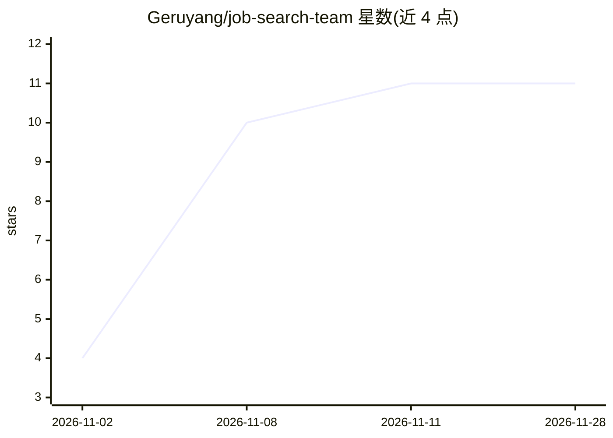

# Geruyang/job-search-team

⭐ 11 · JavaScript · MIT · 推送 2026-11-08 · [GitHub](https://github.com/Geruyang/job-search-team) · 个人维护

**帮求职者按自定规则筛选岗位并授权沟通投递的 Agent 技能**

一个可迁移的求职 Agent Skill，附带 BOSS 直聘/猎聘本机网页助手（浏览器扩展+本地服务+CLI）。用户设定评分权重（匹配/成长/薪资性价比/用工评价/行业知名度）与一票否决项，AI 分角色完成岗位搜索收集、证据核验评分、简历检查与沟通草稿准备；区分聊天送达/附件发送/实际投递，未授权不外发。运行代码只用 Node 内置模块，要求 Node.js ≥22 与 Chromium 兼容浏览器，需用户本机登录招聘平台并按验收表自行验收。

## 筛选速览

| 维度 | 判定 | 备注 |
|---|---|---|
| AI 角色 | `ai-native` | 本体是模型或模型工具 |
| 许可风险 | `permissive` | MIT |
| 部署形态 | `library` | 以包/库形式分发 |
| 模型依赖 | — | README 未给出锁定关系 |
| 硬件要求 | — | 无带数字的原话,不猜 |
| 安装摩擦 | `low` | 无编译、无系统依赖或容器化 |
| 成熟度 | — | 结构信号不足 |

## 能力要点

- 可调评分权重与用户确认的一票否决规则，未知项保持未知不虚构分数
- 多智能体分工或单模型按角色顺序执行，不绑定模型提供方
- 本机网页助手支持 Chrome 截图与自动切页，适配 BOSS 直聘与猎聘
- 101 项自动测试通过，支持可选本地经验库先查后处理

## 适用场景

- 按我的评分权重和底线自动筛选 BOSS/猎聘岗位
- 投递前让 AI 核对证据并准备沟通草稿，未经授权不外发
- 跟踪 HR 意向并对超期未回复岗位做例行复查

## 场景标签

`多智能体` `浏览器自动化` · 领域:Agent 开发

## 证据(README 行号)

> L5: 一个可迁移、可配置的求职 Agent Skill，附带 BOSS 直聘 / 猎聘本机网页助手。你决定求职方向、评分权重和一票否决项；AI 负责整理证据、分工执行和核对结果。
> L15: 这个技能把这些步骤组织成一支求职小组：搜索收集岗位，评估核对证据，资料角色检查简历，沟通角色准备介绍和处理回执。支持多个智能体分工，也可以由一个模型按角色顺序完成。
> L29: |可迁移|不绑定模型提供方，不依赖作者的项目路径或账号|

## 星数曲线

2026-11-02 4 → 2026-11-28 11（+7）

---
*卡片 v1 · prompt 1.4 · 生成 2026-11-19 · 置信度 mid · 依据 README sha `2e6e0ca47fa8` · [字段定义](../../DATASET.md)*
