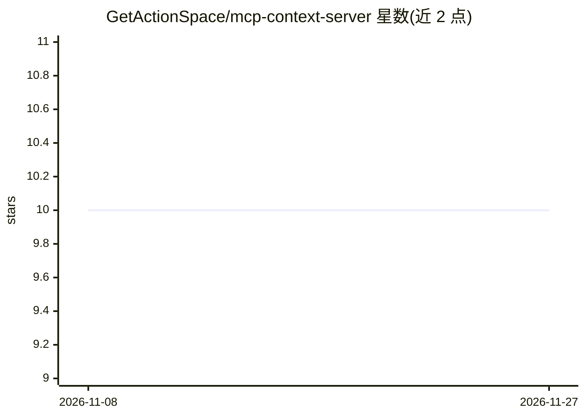

# GetActionSpace/mcp-context-server

⭐ 10 · Python · NOASSERTION · 推送 2026-11-25 · [GitHub](https://github.com/GetActionSpace/mcp-context-server) · [官网](https://www.alexfeel.info/promo/mcp-context-server/) · 组织维护

**为 LLM agent 提供持久化多模态上下文存储的 MCP 服务器**

基于 FastMCP 的 Model Context Protocol 服务器，为多个协作 agent 提供持久化的文本与图像上下文存储：通过线程 ID 实现作用域共享，支持 UUIDv7 标识、逐条记录访问控制（JWT、共享授权、匿名只读令牌）、全文/语义/混合搜索（FTS5/tsvector、向量检索、RRF 融合、FlashRank 交叉编码器重排）、16 算子元数据过滤、可选 LLM 摘要生成与知识库语料同步，共暴露 21 个 MCP 工具。数据库后端为 SQLite（默认零配置）或 PostgreSQL，提供 Docker Compose 与 Helm/Kubernetes 部署配置，v2.x 升级需一次性数据迁移。许可为 Elastic License 2.0。

## 筛选速览

| 维度 | 判定 | 备注 |
|---|---|---|
| AI 角色 | `ai-ecosystem` | LLM/agent 周边工具 |
| 许可风险 | `none` | NOASSERTION |
| 部署形态 | `self-host` | docker 或自建部署 |
| 模型依赖 | local-ok | 支持本地模型 |
| 硬件要求 | — | 无带数字的原话,不猜 |
| 安装摩擦 | `low` | 无编译、无系统依赖或容器化 |
| 成熟度 | — | 结构信号不足 |

## 能力要点

- 文本与图像持久化存储，线程作用域实现多 agent 上下文共享
- 全文/语义/混合搜索三模式，附 FlashRank 交叉编码器重排
- 逐条记录访问控制，支持 JWT 身份与匿名只读令牌
- SQLite/PostgreSQL 双后端，Docker Compose 与 Helm 部署配置

## 适用场景

- 为多个协作 agent 提供共享的持久化任务上下文
- 将手册/运维文档语料同步供 agent 检索与导航
- 需要记录级权限控制的多用户上下文服务部署

## 场景标签

`Agent 记忆` · 领域:Agent 开发

## 证据(README 行号)

> L7: A high-performance Model Context Protocol (MCP) server providing persistent multimodal context storage for LLM agent
> L38: - **MCP Standard Compliance**: Works with Claude Code, LangGraph, and any MCP-compatible client
> L83: The MCP Context Server exposes 21 MCP tools for context management:

## 星数曲线

2026-11-08 10 → 2026-11-27 10（+0）

---
*卡片 v1 · prompt 1.4 · 生成 2026-11-20 · 置信度 high · 依据 README sha `1e3a22fc5ef8` · [字段定义](../../DATASET.md)*
