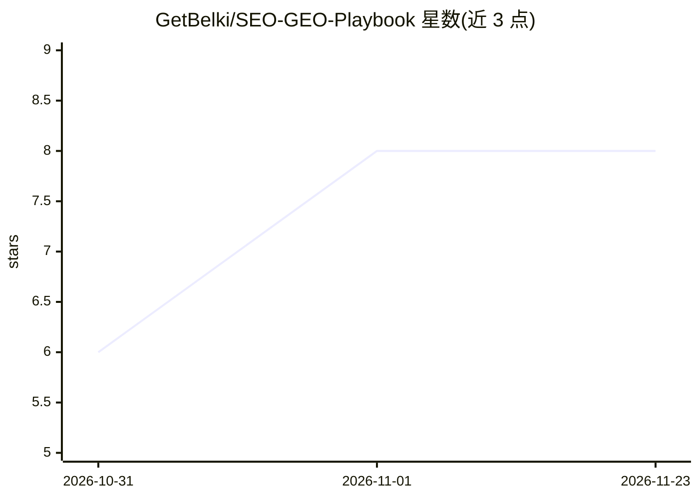

# GetBelki/SEO-GEO-Playbook

⭐ 8 · CC-BY-4.0 · 推送 2026-11-17 · [GitHub](https://github.com/GetBelki/SEO-GEO-Playbook) · [官网](https://getbelki.com) · 个人维护

**面向电商的 SEO/GEO 知识库：AI 助手可引用的带出处参考**

一个以 Markdown 组织的 SEO 与 AI 搜索可见性（GEO）知识库，面向电商场景，保持品牌中立。内容覆盖 Google 与 ChatGPT、Gemini、Claude、Perplexity 等助手如何检索、排名与引用页面，给出 51 条规则、36 篇诊断测试、29 条来源分歧记录，每条声明均带 7 级置信标签与约 480 条脚注出处。可直接放入项目或作为 git submodule 供 AI agent 引用，页面遵循 OKF v0.2 格式并标注 stale_after 日期。

## 筛选速览

| 维度 | 判定 | 备注 |
|---|---|---|
| AI 角色 | `ai-knowledge` | 知识聚合/清单类 |
| 许可风险 | `viral` | CC-BY-4.0 |
| 部署形态 | `None` |  |
| 模型依赖 | — | README 未给出锁定关系 |
| 硬件要求 | — | 无带数字的原话,不猜 |
| 安装摩擦 | `low` | 无编译、无系统依赖或容器化 |
| 成熟度 | — | 结构信号不足 |

## 能力要点

- 36 页、51 条规则，每条链接到对应证据
- 约 480 条脚注来源与 7 级置信标签体系（Measured/Official/Patent 等）
- 29 条来源分歧以书面形式记录而非默认裁决
- 纯 Markdown+相对链接，可被 AI agent 作为参考读取

## 适用场景

- 电商站点排查 SEO 与 AI 搜索引用问题
- 作为 AI agent 查询 SEO/GEO 问题的参考知识库
- 核验某条 SEO 规则的来源与证据强度

## 场景标签

 · 领域:营销/搜索优化知识库

## 证据(README 行号)

> L5: A sourced knowledge base for search (SEO) and AI-search visibility (GEO), written for ecommerce and kept brand-neutr
> L7: You can drop it into any project as a reference that you or your AI agent can rely on. Every claim cites its source 
> L59: 1. Copy the `playbook/` folder into your project, or add this repository as a git submodule.

## 星数曲线

2026-10-31 6 → 2026-11-23 8（+2）

---
*卡片 v1 · prompt 1.4 · 生成 2026-11-21 · 置信度 high · 依据 README sha `b6388c46f18b` · [字段定义](../../DATASET.md)*
