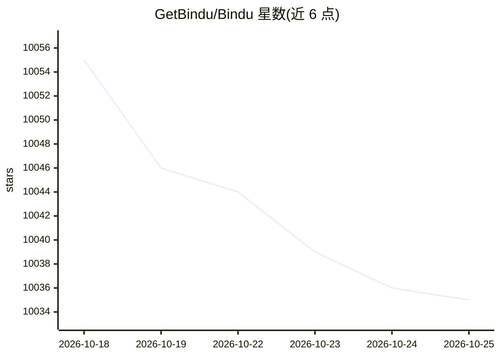

# GetBindu/Bindu

⭐ 10,035 · Python · NOASSERTION · 推送 2026-09-06 · [GitHub](https://github.com/GetBindu/Bindu) · [官网](https://docs.getbindu.com) · 组织维护

**AI agent 的身份、通信与支付基础设施层**

面向 AI agent 开发者的基础设施框架：用 bindufy() 包装用户已有的 agent 处理器，为其提供加密身份（DID/Ed25519 签名）、A2A JSON-RPC 通信、三层默认安全（mTLS、Hydra OAuth2、DID 签名）、x402 USDC 支付（EVM 链）、任务调度与网关编排。框架无关，支持 Agno、LangChain、CrewAI 等多种框架，提供 Python/TypeScript/Kotlin SDK（共享 gRPC 核心）。需要 Python 3.12+ 与 uv，运行示例需 LLM provider API key；任务与消息存储使用 Postgres，调度依赖 Redis。

## 筛选速览

| 维度 | 判定 | 备注 |
|---|---|---|
| AI 角色 | `ai-ecosystem` | LLM/agent 周边工具 |
| 许可风险 | `none` | NOASSERTION |
| 部署形态 | `self-host` | docker 或自建部署 |
| 模型依赖 | — | README 未给出锁定关系 |
| 硬件要求 | — | 无带数字的原话,不猜 |
| 安装摩擦 | `low` | 无编译、无系统依赖或容器化 |
| 成熟度 | — | 结构信号不足 |

## 能力要点

- bindufy() 一次包装即为 agent 提供 DID 身份、A2A 协议与支付能力
- 三层默认安全：mTLS + Hydra OAuth2 + Ed25519 DID 签名
- x402 支付：agent 可在执行前要求 USDC 付款，预配置 5 条 EVM 链
- Python/TypeScript/Kotlin SDK 共享同一 gRPC 核心与 DID 体系

## 适用场景

- 让自建 agent 获得可验证身份并与其他 agent 通过 A2A 通信
- 为 agent 按请求收费（USDC/x402）
- 多 agent 群协作与网关编排（含价格与 SLA 协商）

## 场景标签

`Agent 框架` `多智能体` · 领域:Agent 开发

## 证据(README 行号)

> L29:  The identity, communication, and payments layer for AI agents.
> L39: Bindu is all of that plumbing, behind one function call. You wrap your handler with `bindufy()`, and a few seconds 
> L171: ## Supported frameworks

## 星数曲线

2026-10-18 10,055 → 2026-10-25 10,035（-20）

---
*卡片 v1 · prompt 1.4 · 生成 2026-10-20 · 置信度 mid · 依据 README sha `665e1eb3735f` · [字段定义](../../DATASET.md)*
