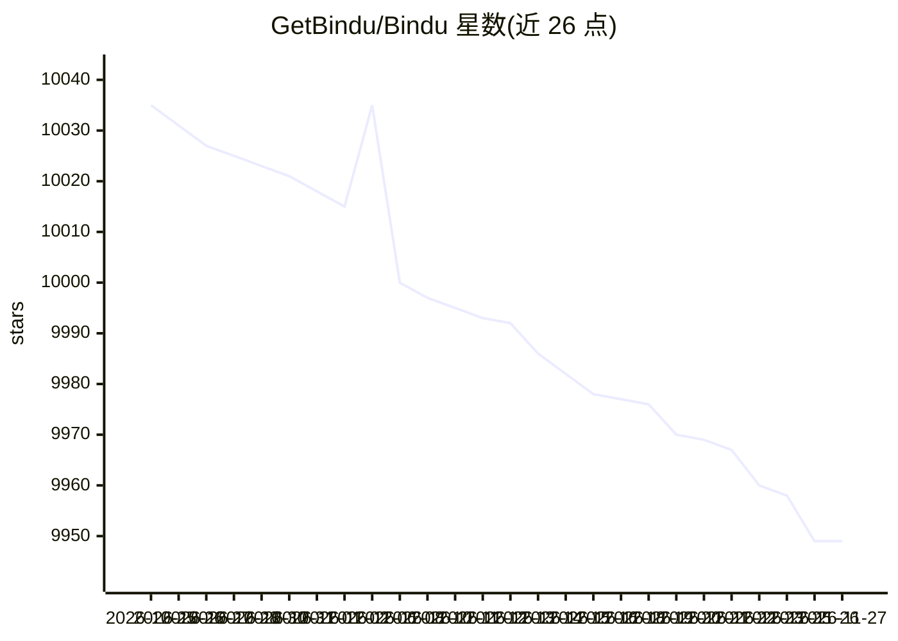

# GetBindu/Bindu

⭐ 9,949 · Python · NOASSERTION · 推送 2026-11-25 · [GitHub](https://github.com/GetBindu/Bindu) · [官网](https://docs.getbindu.com) · 组织维护

**为 AI agent 提供身份、通信与支付基础设施的框架**

以 `bindufy()` 包装 agent 处理函数，为其接入 A2A JSON-RPC 协议、W3C DID 加密身份、OAuth2/mTLS/DID 签名三层安全栈，以及基于 x402 的 USDC 预付支付（支持 5 条预配置 EVM 链及任意 EVM 链扩展）。内置网关（planner LLM 编排多 agent）、任务调度（Redis）、存储（Postgres）、推送通知、公网隧道与微VM 云部署。提供 Python/TypeScript/Kotlin SDK，共享同一 gRPC 核心，handler 内可使用任意 agent 框架。

## 筛选速览

| 维度 | 判定 | 备注 |
|---|---|---|
| AI 角色 | `ai-ecosystem` | LLM/agent 周边工具 |
| 许可风险 | `none` | NOASSERTION |
| 部署形态 | `self-host` | docker 或自建部署 |
| 模型依赖 | — | README 未给出锁定关系 |
| 硬件要求 | — | 无带数字的原话,不猜 |
| 安装摩擦 | `low` | 无编译、无系统依赖或容器化 |
| 成熟度 | — | 结构信号不足 |

## 能力要点

- 一行 bindufy() 接入 A2A 协议、DID 身份与 x402 USDC 支付
- mTLS + OAuth2(Hydra) + Ed25519 DID 签名三层安全中间件
- Python/TypeScript/Kotlin SDK 共享 gRPC 核心
- expose:true 提供公网隧道，无需端口转发

## 适用场景

- 让自建 agent 通过 A2A 协议与其他 agent 互相通信并验证身份
- 为 agent 服务接入按调用付费的加密货币支付
- 用网关编排多 agent 协作并将结果流式返回

## 场景标签

`Agent 框架` `多智能体` · 领域:Agent 开发

## 证据(README 行号)

> L29:  The identity, communication, and payments layer for AI agents.
> L39: Bindu is all of that plumbing, behind one function call. You wrap your handler with `bindufy()`, and a few seconds 
> L141: |**Gateway**|A planner LLM that orchestrates a fleet of agents over A2A and streams the result back.|GATEWAY.md|

## 星数曲线

2026-10-25 10,035 → 2026-11-27 9,949（-86）

---
*卡片 v1 · prompt 1.4 · 生成 2026-11-26 · 置信度 mid · 依据 README sha `107d3beb9070` · [字段定义](../../DATASET.md)*
