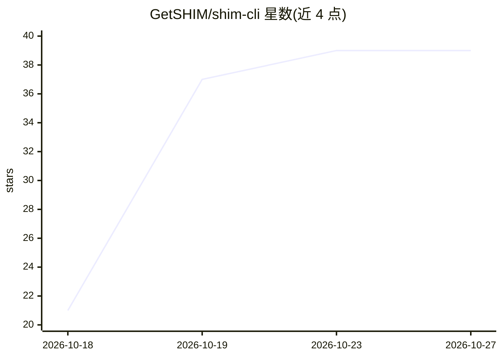

# GetSHIM/shim-cli

⭐ 39 · Python · Apache-2.0 · 推送 2026-10-20 · [GitHub](https://github.com/GetSHIM/shim-cli) · [官网](https://getshim.tech/products/shim-cli) · 组织维护

**给编码代理的本地流量审计与隐私脱敏工具**

面向使用 Claude Code、Codex CLI、GitHub Copilot CLI 和 VS Code 代理的开发者：`shim watch` 在单条命令前放置本地回环代理，逐字节转发不修改，报告 token 分布、成本估算与请求中出现的密钥/个人信息；`shim install` 通过 hook 在模型看到之前对符合条件的工具结果做占位符脱敏，并阻止占位符被写回文件；`shim audit` 读取 `~/.claude/projects` 历史统计已达模型的内容并可选清除。检测为尽力而为，Windows 不支持，`shim watch` 仅支持 Claude Code。

## 筛选速览

| 维度 | 判定 | 备注 |
|---|---|---|
| AI 角色 | `ai-ecosystem` | LLM/agent 周边工具 |
| 许可风险 | `permissive` | Apache-2.0 |
| 部署形态 | `desktop` | 安装包/桌面程序 |
| 模型依赖 | — | README 未给出锁定关系 |
| 硬件要求 | — | 无带数字的原话,不猜 |
| 安装摩擦 | `low` | 无编译、无系统依赖或容器化 |
| 成熟度 | — | 结构信号不足 |

## 能力要点

- 本地代理逐字节转发并报告 token 分布、成本与敏感数据发现
- hook 在模型看到前用占位符（如 <SECRET_1>）脱敏工具结果
- 占位符永不写回其代表的原值，含占位符的写入被拒绝
- `shim audit` 离线读取 Claude Code 历史统计并可选清除记录

## 适用场景

- 查看我的编码 agent 到底往模型发了什么、花了多少 token 和费用
- 防止 .env 中的密钥和个人数据被发送给模型
- 审计过去几个月 Claude Code 会话历史中已外发的敏感内容

## 场景标签

`网络安全` `LLM 可观测性` · 领域:评测与运维

## 证据(README 行号)

> L17: shim-cli shows you what your coding agent actually sends to the model — how
> L71: `shim watch` puts a local proxy in front of the client for one command, forwards
> L194: |Client|Your typed prompt|Tool input and results|

## 星数曲线

2026-10-18 21 → 2026-10-27 39（+18）

---
*卡片 v1 · prompt 1.4 · 生成 2026-10-25 · 置信度 high · 依据 README sha `6375984b8d25` · [字段定义](../../DATASET.md)*
