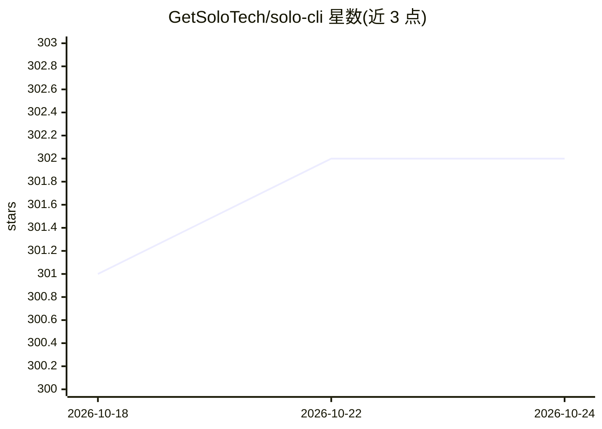

# GetSoloTech/solo-cli

⭐ 302 · Python · Apache-2.0 · 推送 2026-04-11 · [GitHub](https://github.com/GetSoloTech/solo-cli) · [官网](https://getsolo.tech/) · 组织维护

**面向 Physical AI 的命令行工具：微调并部署边缘端模型**

Python 3.12+ 的 CLI 工具，用于在本地/边缘硬件上部署 Physical AI：通过 Solo Hub 认证与下载模型，solo serve 以 Ollama 等为服务端启动本地模型，暴露 OpenAI 兼容与 Ollama API 端点；solo robo 提供机器人校准、遥操作、录制与训练流程，依赖 solo-bot（需 Git LFS）。另提供 OpenClaw 技能包，让 AI 代理代为执行命令。经 git clone + uv pip install -e . 源码安装，Docker 为 solo serve 的前提。

## 筛选速览

| 维度 | 判定 | 备注 |
|---|---|---|
| AI 角色 | `ai-ecosystem` | LLM/agent 周边工具 |
| 许可风险 | `permissive` | Apache-2.0 |
| 部署形态 | `library` | 以包/库形式分发 |
| 模型依赖 | local-ok | 支持本地模型 |
| 硬件要求 | — | 无带数字的原话,不猜 |
| 安装摩擦 | `low` | 无编译、无系统依赖或容器化 |
| 成熟度 | — | 结构信号不足 |

## 能力要点

- solo serve 支持以 Ollama 为服务端启动本地模型（如 llama3.2:1b）
- 提供 OpenAI 兼容与 Ollama 两种 API 端点
- solo robo 覆盖机器人校准、遥操作、录制与训练
- OpenClaw 技能包支持 AI 代理自动执行命令

## 适用场景

- 在本地/边缘设备上部署和运行语言/视觉模型
- 通过 CLI 完成机器人手臂的校准与遥操作采集
- 以 OpenAI 兼容接口在终端环境调用本地模型

## 场景标签

`微调` `推理引擎` · 领域:训练与推理

## 证据(README 行号)

> L9: **Fastest way to deploy Physical AI on your hardware**
> L11: Simple CLI for Physical AI:
> L115: solo serve --server ollama --model llama3.2:1b

## 星数曲线

2026-10-18 301 → 2026-10-24 302（+1）

---
*卡片 v1 · prompt 1.4 · 生成 2026-10-21 · 置信度 mid · 依据 README sha `d3c95ac4c48f` · [字段定义](../../DATASET.md)*
