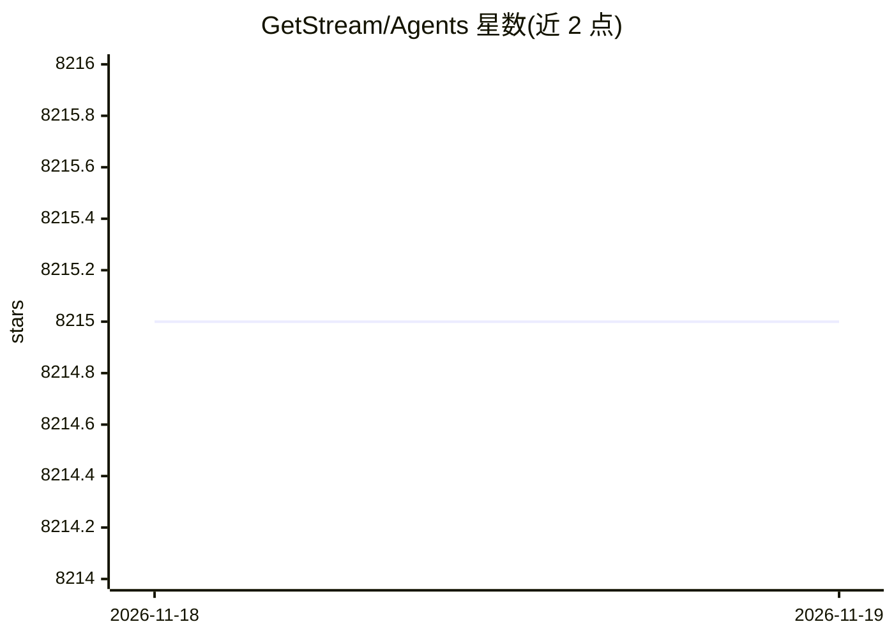

# GetStream/Agents

⭐ 8,215 · Go · Apache-2.0 · 推送 2026-11-18 · [GitHub](https://github.com/GetStream/Agents) · [官网](https://visionagents.ai) · 组织维护

**Go 后端多语言 SDK，快速构建文本/语音/视频 AI agent**

Stream Agents 是用 Go 实现的 agent 后端，配套 Python/Go/Node/Ruby/PHP/.NET/Rust 等后端 SDK 与 Swift/Kotlin/React/Flutter/React Native 客户端 SDK，用于构建文本、语音、视频形式的 AI agent 应用。Agent 以文件夹结构 + YAML 定义，内置 Guardrails、知识库、路由、连接器（Slack/WhatsApp/Linear 等）、沙箱、电话、记忆与持久化等组件，提供模型路由以切换底层 LLM/STT，含成本监控与消费限额。可自托管或使用带免费额度的托管版本（Go 核心由 Stream 提供）。

## 筛选速览

| 维度 | 判定 | 备注 |
|---|---|---|
| AI 角色 | `ai-ecosystem` | LLM/agent 周边工具 |
| 许可风险 | `permissive` | Apache-2.0 |
| 部署形态 | `None` |  |
| 模型依赖 | — | README 未给出锁定关系 |
| 硬件要求 | — | 无带数字的原话,不猜 |
| 安装摩擦 | `low` | 无编译、无系统依赖或容器化 |
| 成熟度 | — | 结构信号不足 |

## 能力要点

- Agent 以文件夹 + YAML 定义，CLI 一键初始化与测试
- 文本/语音/视频三形态，含电话呼入呼出示例
- 内置 LLM/STT 路由、内存/知识库、MCP 工具与 20+ 连接器
- 会话级 token 用量监控与日/周/月消费限额

## 适用场景

- 快速搭建带知识库与工具调用的客服或业务 agent
- 构建语音/视频 agent（来电接单、外呼筛选、监控摄像头等）
- 需要控制 AI 成本并在多模型间切换的团队

## 场景标签

`Agent 框架` · 领域:Agent 开发

## 证据(README 行号)

> L6: Stream Agents is a Go backend for building text, voice and video agents.
> L11: 1. Agents are defined in a folder structure + YAML
> L124: * Routing for LLM and STT

## 星数曲线

2026-11-18 8,215 → 2026-11-19 8,215（+0）

---
*卡片 v1 · prompt 1.4 · 生成 2026-11-18 · 置信度 high · 依据 README sha `a3b71bb69fb9` · [字段定义](../../DATASET.md)*
