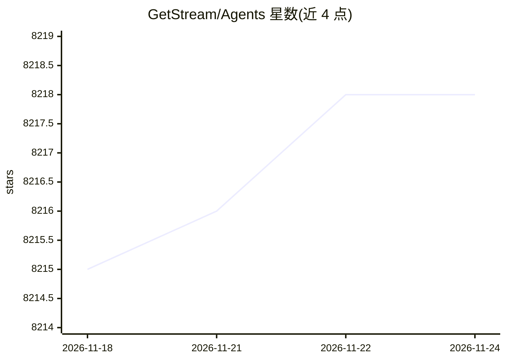

# GetStream/Agents

⭐ 8,218 · Go · Apache-2.0 · 推送 2026-11-24 · [GitHub](https://github.com/GetStream/Agents) · [官网](https://visionagents.ai) · 组织维护

**Go 后端框架：构建文本/语音/视频 AI Agent**

Stream Agents 是用于构建文本、语音和视频 agent 的 Go 后端。Agent 通过文件夹结构加 YAML 定义，配套多种后端语言（Python/Go/Node/Ruby/PHP/.NET/Rust）与客户端 SDK（Swift/Kotlin/React/Flutter/React Native）。内置 LLM 与 STT 路由、知识库、技能、工具调用与 MCP、电话收拨、Slack/WhatsApp 等连接器、会话持久化、沙箱、搜索、仿真测试与监控，并提供按日/周/月的美元消费限额等成本控制手段。支持自托管或使用带免费额度的托管版本。

## 筛选速览

| 维度 | 判定 | 备注 |
|---|---|---|
| AI 角色 | `ai-ecosystem` | LLM/agent 周边工具 |
| 许可风险 | `permissive` | Apache-2.0 |
| 部署形态 | `None` |  |
| 模型依赖 | — | README 未给出锁定关系 |
| 硬件要求 | — | 无带数字的原话,不猜 |
| 安装摩擦 | `low` | 无编译、无系统依赖或容器化 |
| 成熟度 | — | 结构信号不足 |

## 能力要点

- 文件夹结构 + YAML 定义 agent，CLI 一键初始化与测试
- 多语言后端 SDK 与六种客户端 SDK，覆盖 chat/voice/video
- 内置 LLM/STT 路由、电话、连接器、记忆与持久化、沙箱
- Session/聚合级 token 统计与按组织的支出限额

## 适用场景

- 给应用快速加上文本/语音/视频 agent 能力
- 接听呼入电话自动处理订单或筛选候选人
- 在多个底层模型间切换并控制 AI 成本
- 用仿真脚本在上线前回归测试 agent 行为

## 场景标签

`Agent 框架` · 领域:Agent 开发

## 证据(README 行号)

> L6: Stream Agents is a Go backend for building text, voice and video agents.
> L11: 1. Agents are defined in a folder structure + YAML
> L13: 3. All the components you need are integrated with sensible defaults. (Guardrails, Knowledge, Routing, Connectors, 

## 星数曲线

2026-11-18 8,215 → 2026-11-24 8,218（+3）

---
*卡片 v1 · prompt 1.4 · 生成 2026-11-22 · 置信度 high · 依据 README sha `29335204cfa8` · [字段定义](../../DATASET.md)*
