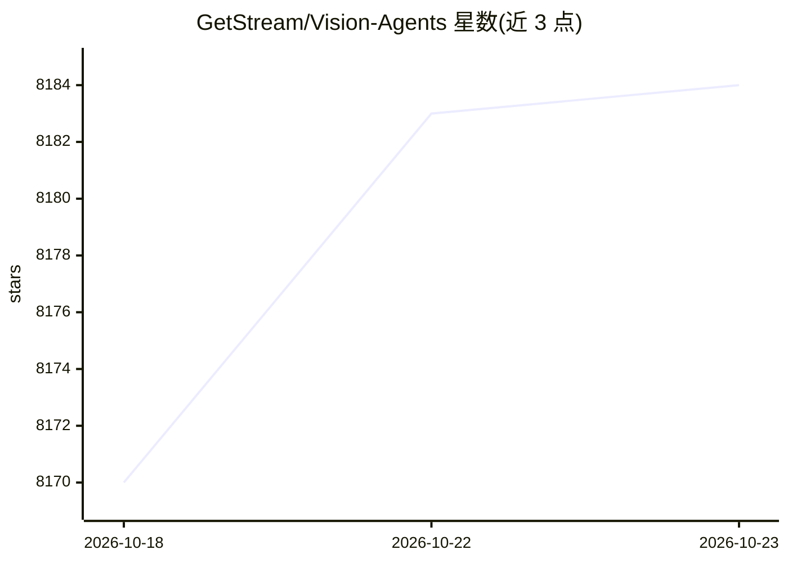

# GetStream/Vision-Agents

⭐ 8,184 · Python · Apache-2.0 · 推送 2026-10-22 · [GitHub](https://github.com/GetStream/Vision-Agents) · [官网](https://visionagents.ai) · 组织维护

**构建实时语音/视觉 Agent 的开源框架（Stream 出品）**

由 Stream 团队维护的多模态实时 Agent 构建框架：通过 WebRTC 将视频流直送模型，支持在 LLM 调用前后接入 YOLO/Roboflow/自定义 PyTorch/ONNX 处理管线，内置 VAD 说话人分离、工具调用与 MCP、电话集成（Twilio/Telnyx）、RAG（TurboPuffer/Qdrant）与 Prometheus 指标、Kubernetes 部署等生产特性。默认使用 Stream 边缘网络（需 Stream API key），也可配合其他视频边缘网络；提供 React/Android/iOS/Flutter/React Native/Unity SDK。README 声明当前限制：小字识别易幻觉、约 30 秒以上会话上下文退化、多数场景需专用模型与大 LLM 组合。

## 筛选速览

| 维度 | 判定 | 备注 |
|---|---|---|
| AI 角色 | `ai-ecosystem` | LLM/agent 周边工具 |
| 许可风险 | `permissive` | Apache-2.0 |
| 部署形态 | `library` | 以包/库形式分发 |
| 模型依赖 | locked-api |  |
| 硬件要求 | — | 无带数字的原话,不猜 |
| 安装摩擦 | `low` | 无编译、无系统依赖或容器化 |
| 成熟度 | — | 结构信号不足 |

## 能力要点

- WebRTC 实时视频直送模型，加入 500ms、音视频延迟低于 30ms
- 可插拔处理管线：YOLO/Roboflow/自定义 PyTorch/ONNX
- 集成 40+ 供应商：LLM/Realtime/STT/TTS/Vision/RAG 分类列出
- 内置 HTTP 服务器、Prometheus 指标、水平扩展与 Kubernetes 部署

## 适用场景

- 搭建实时语音 Agent 通话应用
- 结合 YOLO 等视觉模型做实时视频理解（安防、教练、康复等）
- 通过电话线路（Twilio/Telnyx）接入语音 Agent

## 场景标签

`语音 Agent` `RAG` `多模态` · 领域:对话与助手

## 证据(README 行号)

> L16: Vision Agents give you the building blocks to create intelligent, low-latency video experiences powered by your mod
> L69: |**Video Processing**|Pluggable processor pipeline for YOLO, Roboflow, or custom PyTorch/ONNX models before/after L

## 星数曲线

2026-10-18 8,170 → 2026-10-23 8,184（+14）

---
*卡片 v1 · prompt 1.4 · 生成 2026-10-20 · 置信度 high · 依据 README sha `0ff1d4fc3f65` · [字段定义](../../DATASET.md)*
