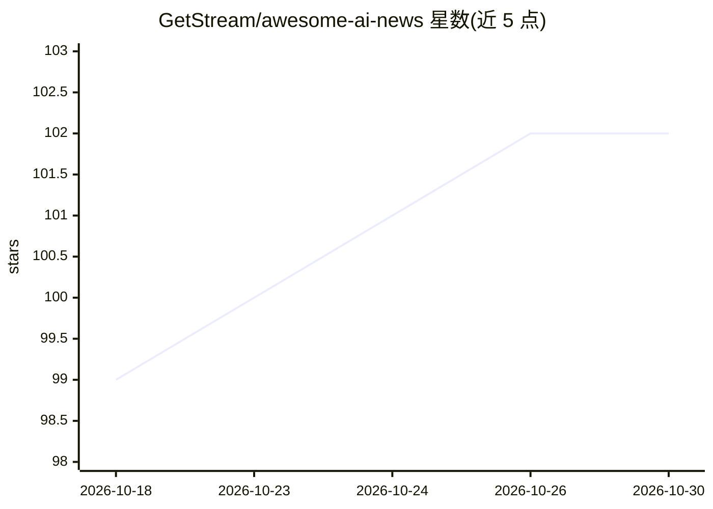

# GetStream/awesome-ai-news

⭐ 102 · 推送 2026-10-29 · [GitHub](https://github.com/GetStream/awesome-ai-news) · 组织维护

**面向开发者的 AI 新闻月度清单，按月汇总模型与工具动态**

由 GetStream 维护的 AI 资讯聚合仓库：按月份（2026 年 7-10 月）以链接条目形式记录模型发布、API 更新、收购与开源项目动态，条目覆盖 Anthropic、OpenAI、Google、DeepSeek、Qwen、Mistral 等厂商的消息。仓库本体是纯 Markdown 清单，无代码、无安装步骤，读者通过浏览条目并跳转外部链接获取详情。目标读者为跟进 AI 进展的开发者。

## 筛选速览

| 维度 | 判定 | 备注 |
|---|---|---|
| AI 角色 | `ai-knowledge` | 知识聚合/清单类 |
| 许可风险 | `none` | — |
| 部署形态 | `None` |  |
| 模型依赖 | — | README 未给出锁定关系 |
| 硬件要求 | — | 无带数字的原话,不猜 |
| 安装摩擦 | `low` | 无编译、无系统依赖或容器化 |
| 成熟度 | — | 结构信号不足 |

## 能力要点

- 按月组织的 AI 新闻与资源条目列表
- 条目链接指向模型发布、API、开源项目等外部来源
- 覆盖多家厂商的模型与工具动态

## 适用场景

- 按月回顾 AI 模型与工具的重要动态
- 发现新发布的模型与 API 资源
- 作为开发者的 AI 资讯追踪入口

## 场景标签

`精选清单` · 领域:学习与行业

## 证据(README 行号)

> L3: AI is changing faster than developers can keep up. This repo is a monthly collection of AI news and resources for de
> L5: ## October 2026

## 星数曲线

2026-10-18 99 → 2026-10-30 102（+3）

---
*卡片 v1 · prompt 1.4 · 生成 2026-10-23 · 置信度 high · 依据 README sha `24c879c83109` · [字段定义](../../DATASET.md)*
