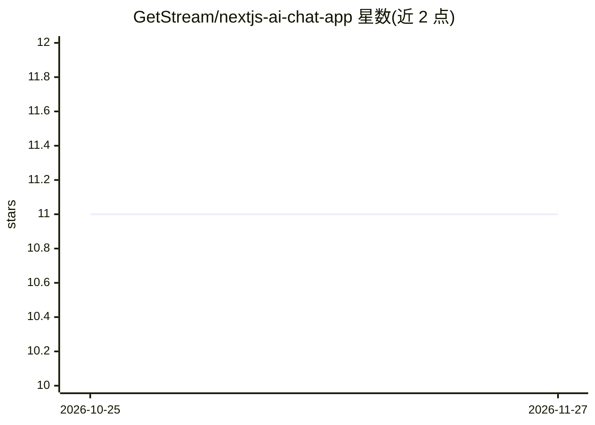

# GetStream/nextjs-ai-chat-app

⭐ 11 · TypeScript · 推送 2026-11-23 · [GitHub](https://github.com/GetStream/nextjs-ai-chat-app) · [官网](https://getstream.io/blog/ai-chat-nextjs/) · 组织维护

**演示在 Next.js 聊天应用中接入流式 AI 回复的示例工程**

基于 Stream React Chat SDK 的 Next.js 聊天应用示例，演示如何在现代聊天架构中加入流式聊天机器人回答与 LLM 动生成频道名称。本地运行需三步：在 Stream Dashboard 创建账号获取 API key 与 Secret 配置到 .env.local；本地运行 LLM 服务（README 使用 LM Studio 加载 Llama-3.2-3B-Instruct-4bit，端口 1234，也可用其他工具）；npm/yarn 安装依赖并启动开发服务器。依赖 Stream 托管后端，需在代码中填写实际 userId 与 userName。

## 筛选速览

| 维度 | 判定 | 备注 |
|---|---|---|
| AI 角色 | `ai-native` | 本体是模型或模型工具 |
| 许可风险 | `none` | — |
| 部署形态 | `library` | 以包/库形式分发 |
| 模型依赖 | — | README 未给出锁定关系 |
| 硬件要求 | — | 无带数字的原话,不猜 |
| 安装摩擦 | `low` | 无编译、无系统依赖或容器化 |
| 成熟度 | — | 结构信号不足 |

## 能力要点

- 流式聊天机器人回答与 LLM 生成动态频道命名
- React Server Actions 与 route handlers、App Router 架构
- 本地 LLM 运行（示例用 LM Studio，端口 1234）
- TailwindCSS 样式与 Stream Chat React 集成

## 适用场景

- 学习如何在 Next.js 聊天应用中集成流式 AI 回复
- 以此为模板搭建接入 Stream SDK 的聊天前端
- 体验本地 LLM 与托管聊天后端的组合开发

## 场景标签

`聊天机器人` · 领域:对话与助手

## 证据(README 行号)

> L5: This repository demonstrates how to build a Next.js chat application with modern architecture using Stream's React C
> L12: - Streaming chatbot answers

## 星数曲线

2026-10-25 11 → 2026-11-27 11（+0）

---
*卡片 v1 · prompt 1.4 · 生成 2026-11-19 · 置信度 high · 依据 README sha `28f44d93515d` · [字段定义](../../DATASET.md)*
