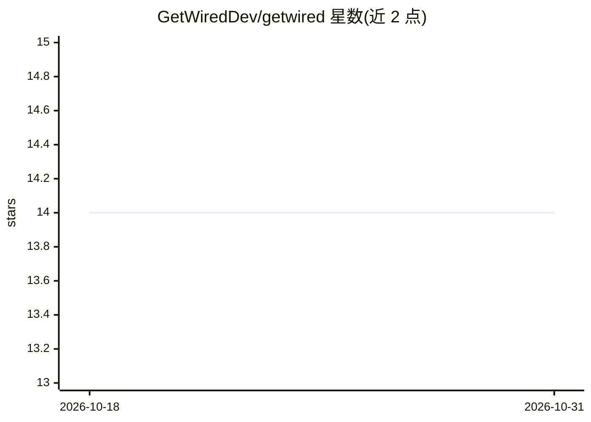

# GetWiredDev/getwired

⭐ 14 · TypeScript · MIT · 推送 2026-06-17 · [GitHub](https://github.com/GetWiredDev/getwired) · [官网](https://getwired.dev) · 组织维护

**AI 驱动的混沌测试 CLI：模拟真人搞破坏找 bug**

面向 Web 与原生 Android/iOS 应用的命令行测试工具：由所选 AI agent 像混乱的真实用户一样操作应用——随机点击链接、输入乱码、连点按钮，以发现 bug、XSS 漏洞与布局破损。工作流为 init（扫描项目、检测框架/模拟器）→ test（AI 驱动探索）→ report（生成含截图的 HTML 报告）。支持 Claude Code、Auggie、Codex、OpenCode 四类 provider，可作 MCP 服务器接入 Claude Code、Cursor、Windsurf、Codex 等 coding agent。限制：Web 仅测 localhost/回环地址，不针对线上站点。通过 npm 全局安装。

## 筛选速览

| 维度 | 判定 | 备注 |
|---|---|---|
| AI 角色 | `ai-ecosystem` | LLM/agent 周边工具 |
| 许可风险 | `permissive` | MIT |
| 部署形态 | `library` | 以包/库形式分发 |
| 模型依赖 | locked-api |  |
| 硬件要求 | — | 无带数字的原话,不猜 |
| 安装摩擦 | `low` | 无编译、无系统依赖或容器化 |
| 成熟度 | — | 结构信号不足 |

## 能力要点

- AI 模拟混乱真人行为进行探索式测试，覆盖 bug/XSS/布局问题
- 支持 Web（localhost）与原生 Android 模拟器/iOS Simulator
- 提供 MCP 服务器模式，供 AI coding agent 直接调用测试
- 生成含截图与严重度分类的 HTML 测试报告

## 适用场景

- 上线前用 AI 混沌测试提前发现 Web 应用的 bug 和 XSS 漏洞
- 在 Android/iOS 模拟器上对移动构建做探索式测试
- 让 Cursor/Claude Code 等 coding agent 通过 MCP 直接跑测试

## 场景标签

`浏览器自动化` `GUI 自动化` · 领域:效率与自动化

## 证据(README 行号)

> L44: |`getwired test`|Run AI-driven chaotic testing against your local dev server|
> L6: Break your app before your users do. GetWired uses AI to test your web apps and native Android & iOS apps like a cha

## 星数曲线

2026-10-18 14 → 2026-10-31 14（+0）

---
*卡片 v1 · prompt 1.4 · 生成 2026-10-31 · 置信度 high · 依据 README sha `0b9d17be08ad` · [字段定义](../../DATASET.md)*
