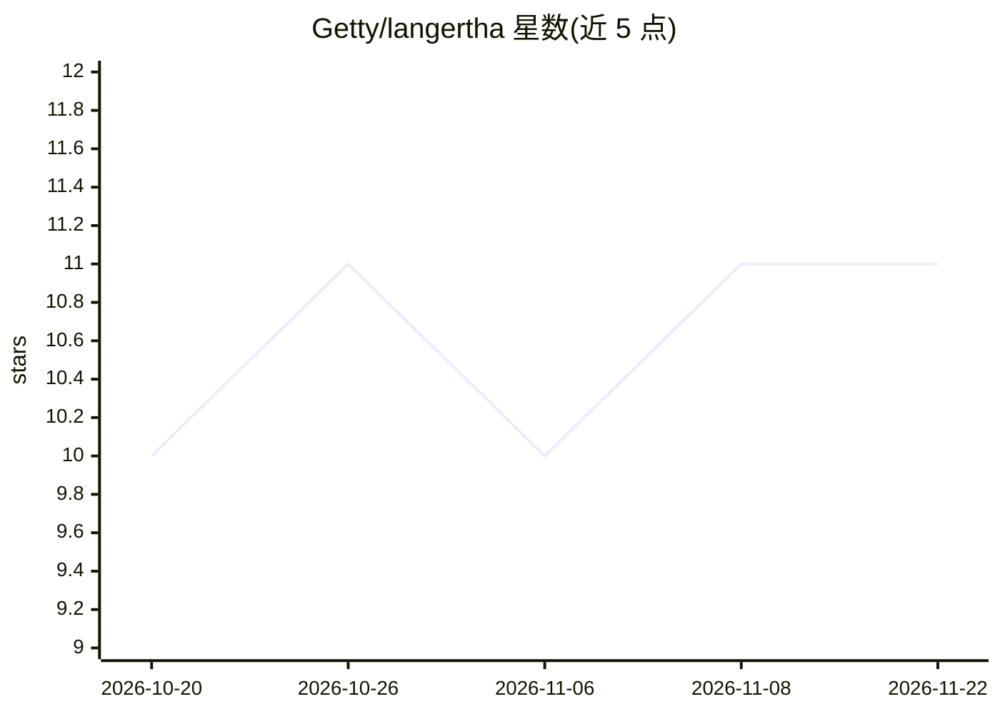

# Getty/langertha

⭐ 11 · Perl · NOASSERTION · 推送 2026-11-20 · [GitHub](https://github.com/Getty/langertha) · [官网](https://metacpan.org/dist/Langertha) · 个人维护

**Perl 开发者的统一 LLM API 接口框架**

统一的 Perl LLM API 接口框架，一份 API 覆盖约 20 家提供方，支持聊天、流式输出、嵌入、图像、转录、MCP 工具调用与模型发现。架构分四层：Engine（提供方适配器）、Wrappers（Chat/Embedder/ImageGen 门面）、Raider（自治 agent）、Raid（Sequential/Parallel/Loop 工作流编排）。提供 Hermes 格式工具调用的提示注入回退路径、按提供方自动改写 tool/response_format 形态、能力门控检查（supports 方法）。通过 CPAN 安装，含 OpenAI Responses API 适配。

## 筛选速览

| 维度 | 判定 | 备注 |
|---|---|---|
| AI 角色 | `ai-ecosystem` | LLM/agent 周边工具 |
| 许可风险 | `none` | NOASSERTION |
| 部署形态 | `None` |  |
| 模型依赖 | local-ok | 支持本地模型 |
| 硬件要求 | — | 无带数字的原话,不猜 |
| 安装摩擦 | `low` | 无编译、无系统依赖或容器化 |
| 成熟度 | — | 结构信号不足 |

## 能力要点

- 一份 API 接入约 20 家提供方，含表格化能力矩阵
- MCP 工具调用循环自动执行并回喂结果
- Hermes XML 工具调用回退路径，覆盖无 API 级工具的模型
- Raider agent 与 Raid 工作流编排层

## 适用场景

- 在 Perl 项目中接入多家 LLM 提供方
- 为本地 Ollama/vLLM 模型构建 Perl 调用层
- 组合 agent 节点做顺序/并行/循环工作流编排
- 为无原生工具支持的模型注入 Hermes 格式工具

## 场景标签

`模型网关` `Agent 框架` · 领域:Agent 开发

## 证据(README 行号)

> L10: **Langertha** is a unified Perl interface for LLM APIs. One API, many providers. Supports chat, streaming, embeddin
> L56: Langertha architecture: Engine, Wrappers, Raider, Raid
> L58: - **Engine** (provider API adapter) — low-level provider calls: chat, streaming, tools,

## 星数曲线

2026-10-20 10 → 2026-11-22 11（+1）

---
*卡片 v1 · prompt 1.4 · 生成 2026-11-19 · 置信度 high · 依据 README sha `531175004080` · [字段定义](../../DATASET.md)*
