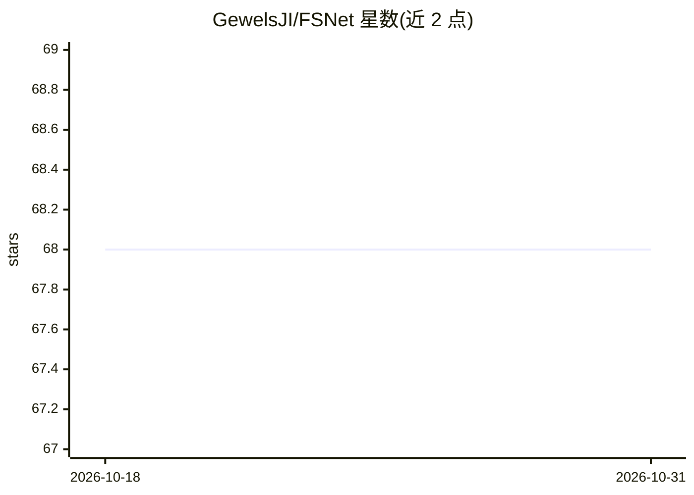

# GewelsJI/FSNet

⭐ 68 · Python · Apache-2.0 · 推送 2026-04-01 · [GitHub](https://github.com/GewelsJI/FSNet) · 个人维护 · 中文 README

**ICCV 2021 视频目标分割论文 FSNet 的官方 PyTorch 代码**

FSNet（Full-duplex Strategy Network）的官方实现仓库，发表于 ICCV 2021，期刊扩展版刊于 Computational Visual Media。模型通过关系交叉注意力模块（RCAM）实现外观与运动嵌入子空间的双向消息传递，并以双向净化模块（BPM）校准时空嵌入间的不一致特征，用于无监督视频目标分割（U-VOS）与视频显著性目标检测（V-SOD），在 DAVIS16、FBMS、MCL、SegTrack-V2、DAVSOD19 五个基准上提供评测结果。仓库提供推理脚本、三阶段训练脚本、预训练权重与预计算结果，依赖 PyTorch 1.1+、scipy、PIL，数据经百度网盘或 Google Drive 下载。README 声明项目仍在建设中。

## 筛选速览

| 维度 | 判定 | 备注 |
|---|---|---|
| AI 角色 | `ai-native` | 本体是模型或模型工具 |
| 许可风险 | `permissive` | Apache-2.0 |
| 部署形态 | `None` |  |
| 模型依赖 | — | README 未给出锁定关系 |
| 硬件要求 | — | 无带数字的原话,不猜 |
| 安装摩擦 | `low` | 无编译、无系统依赖或容器化 |
| 成熟度 | `idea` | |

## 能力要点

- RCAM 实现外观与运动特征的双向消息传递
- BPM 校准时空嵌入间的不一致特征
- 提供推理、评测代码与三阶段训练脚本
- 提供预训练权重及五个基准上的预计算结果

## 适用场景

- 复现论文在 VOS/V-SOD 基准上的实验结果
- 在 DAVIS16/FBMS 等数据集上训练自己的 FSNet 模型
- 获取论文的预计算分割结果做对比评测

## 场景标签

`目标检测` · 领域:感知与多模态

## 证据(README 行号)

> L11: - This repository provides code for paper "_**Full-Duplex Strategy for Video Object Segmentation**_" accepted by th
> L36: In this paper, we study a novel framework, termed the FSNet (Full-duplex Strategy Network), which designs a relatio

## 星数曲线

2026-10-18 68 → 2026-10-31 68（+0）

---
*卡片 v1 · prompt 1.4 · 生成 2026-10-24 · 置信度 high · 依据 README sha `0fcb1461a6a7` · [字段定义](../../DATASET.md)*
