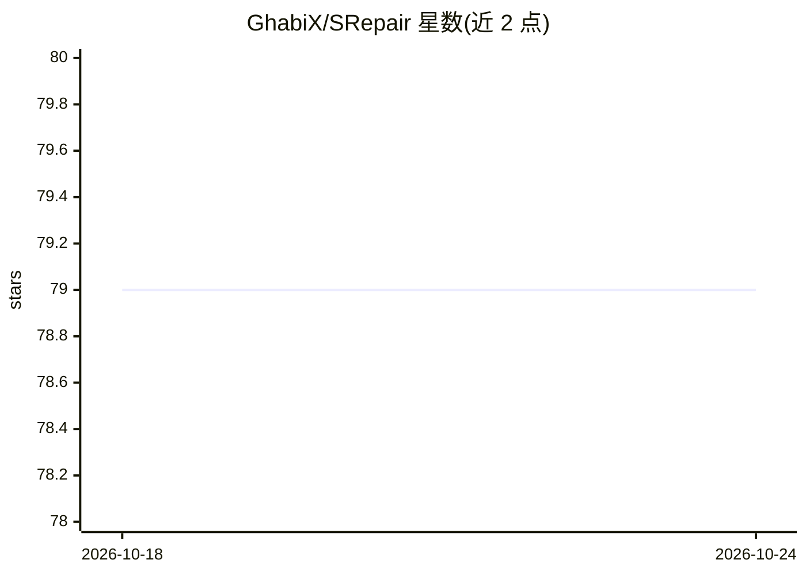

# GhabiX/SRepair

⭐ 79 · Java · 推送 2026-04-23 · [GitHub](https://github.com/GhabiX/SRepair) · 组织维护

**面向 Java 的函数级 LLM 自动程序修复工具（Defects4J）**

学术论文配套的研究型自动程序修复（APR）工具，已被 ACM TOSEM 接收。流程分两步：先用 ChatGPT 类模型结合触发测试、报错信息与注释，以 Chain of Thought 生成自然语言修复建议；再由开源模型（如 Magicoder 7B）按建议生成整函数补丁，最后在 Defects4J 数据集上验证补丁。在 522 个单函数 bug 中正确修复 300 个，平均每个正确修复成本 0.029 美元，并修复 32 个多函数 bug。需 Linux + Docker 与 >20G 显存的 NVIDIA GPU 环境，通过 Dockerfile 构建、Python 脚本分步运行。

## 筛选速览

| 维度 | 判定 | 备注 |
|---|---|---|
| AI 角色 | `ai-native` | 本体是模型或模型工具 |
| 许可风险 | `none` | — |
| 部署形态 | `self-host` | docker 或自建部署 |
| 模型依赖 | — | README 未给出锁定关系 |
| 硬件要求 | — | 无带数字的原话,不猜 |
| 安装摩擦 | `low` | 无编译、无系统依赖或容器化 |
| 成熟度 | — | 结构信号不足 |

## 能力要点

- 两阶段流程：CoT 修复建议生成 + 开源模型整函数补丁生成
- Defects4J 上正确修复 300/522 单函数 bug，平均 $0.029/正确修复
- 修复 32 个多函数 bug
- 不需要语句级故障定位信息

## 适用场景

- 在 Defects4J/QuixBugs 数据集上复现程序修复实验
- 研究函数级与多函数 bug 的自动修复方法
- 对比 LLM-based APR 技术的效果与成本

## 场景标签

`编码 Agent` `科研工具` · 领域:编码与开发

## 证据(README 行号)

> L26: SRepair is the first function-level automated program repair technique, which can achieve remarkable repair perform
> L32: As shown in figure above, SRepair first adopts a *repair suggestion mode*l which utilizes the learning power of LLM

## 星数曲线

2026-10-18 79 → 2026-10-24 79（+0）

---
*卡片 v1 · prompt 1.4 · 生成 2026-10-24 · 置信度 high · 依据 README sha `9587ab5b2dcb` · [字段定义](../../DATASET.md)*
