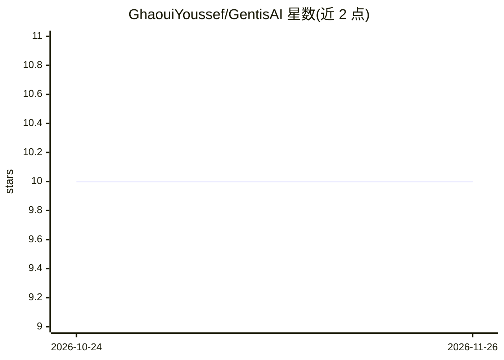

# GhaouiYoussef/GentisAI

⭐ 10 · Python · MIT · 推送 2026-10-05 · [GitHub](https://github.com/GhaouiYoussef/GentisAI) · [官网](https://pypi.org/project/gentis-ai/) · 个人维护

**多专家 AI Agent 路由框架：Expert+Router+Flow 构建 POC**

一个用于构建多专家 AI Agent 原型的 Python 包，核心模型为 Expert + Router + Flow：Router 按专家描述做结构化路由并返回带置信度的 RoutingDecision，Flow 管理会话历史、流式事件与专家执行，支持内存/SQLite 会话持久化与确定性规则路由（无需 LLM）。CLI 提供演示、项目脚手架（init/new/add）、提供方配置与诊断命令，可导出 Streamlit 演示为可编辑项目，并有可选 LangGraph 桥接用于持久化工作流。面向交互式聊天、客服、销售等需要显式路由的工作流开发者。

## 筛选速览

| 维度 | 判定 | 备注 |
|---|---|---|
| AI 角色 | `ai-ecosystem` | LLM/agent 周边工具 |
| 许可风险 | `permissive` | MIT |
| 部署形态 | `library` | 以包/库形式分发 |
| 模型依赖 | local-ok | 支持本地模型 |
| 硬件要求 | — | 无带数字的原话,不猜 |
| 安装摩擦 | `low` | 无编译、无系统依赖或容器化 |
| 成熟度 | — | 结构信号不足 |

## 能力要点

- 结构化路由：Router.classify() 返回含专家列表与置信度的 RoutingDecision
- 零 LLM 的确定性规则路由（rules 参数）
- 内置工具 schema/注册表/执行器与会话 SQLite 持久化
- CLI 脚手架与演示导出，可选 LangGraph 桥接

## 适用场景

- 搭建客服/销售等多专家路由的聊天原型
- 导出演示项目后改造为自己的 Streamlit Agent 应用
- 离线 mock 模式下先测试路由与工具权限再接真实提供方
- 需要时可把 Flow 桥接为 LangGraph 持久化工作流

## 场景标签

`Agent 框架` · 领域:Agent 开发

## 证据(README 行号)

> L3: GentisAI is a small Python package for building multi-expert AI agent POCs with a simple mental model:
> L7: It is designed for interactive chat, support, sales, copilots, and other workflows where routing should be explicit,
> L177: - `BaseLLM`: provider-neutral interface for mock, Gemini, Ollama, Bedrock, and OpenAI-compatible adapters.

## 星数曲线

2026-10-24 10 → 2026-11-26 10（+0）

---
*卡片 v1 · prompt 1.4 · 生成 2026-11-20 · 置信度 high · 依据 README sha `06004184d933` · [字段定义](../../DATASET.md)*
