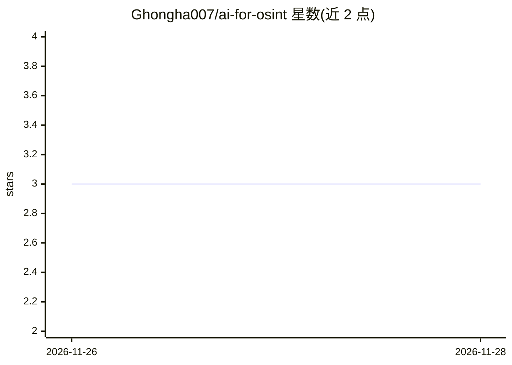

# Ghongha007/ai-for-osint

⭐ 3 · Python · NOASSERTION · 推送 2026-11-26 · [GitHub](https://github.com/Ghongha007/ai-for-osint) · 个人维护

**面向开源调查记者与事实核查者的 AI 工具策展清单（146 条）**

为开源调查员和记者整理的 AI 工具清单，收录 146 条条目，按转录、翻译、OCR/文档、大文档集检索、图像视频验证等类别组织。每条标注运行位置（Local/Cloud，用于源头保护决策）、类型（开源/免费/付费/受限）、已知缺陷与最近活动时间，并给出使用前的三条规则（AI 输出仅作线索、检测器会出错、语音转写可能虚构词句）。明确排除人脸识别私人个体、人肉搜索与渗透测试类工具。所有链接于 2026-11-16 逐条核验。

## 筛选速览

| 维度 | 判定 | 备注 |
|---|---|---|
| AI 角色 | `ai-knowledge` | 知识聚合/清单类 |
| 许可风险 | `none` | NOASSERTION |
| 部署形态 | `None` |  |
| 模型依赖 | — | README 未给出锁定关系 |
| 硬件要求 | — | 无带数字的原话,不猜 |
| 安装摩擦 | `low` | 无编译、无系统依赖或容器化 |
| 成熟度 | — | 结构信号不足 |

## 能力要点

- 146 条条目，每条标注 Local/Cloud 运行位置、类型、已知缺陷与最近活动
- 以源头保护为核心组织字段：区分文件留在本地还是上传第三方服务器
- 记录各工具已文档化的失败模式（如 Whisper 幻觉风险、检测器精度衰减）
- 明确排除人脸识别、人肉搜索与基于泄露数据的工具

## 适用场景

- 为敏感信源材料选择本地运行而非云端的转写或翻译工具
- 调查报道前核验图像视频来源与 C2PA 凭证
- 在泄露文档调查中搭建自托管的大文档集检索
- 评估某 AI 工具在低资源语言或嘈杂音频上的已知局限

## 场景标签

`精选清单` · 领域:学习与行业

## 证据(README 行号)

> L3: AI tools, models and agent tooling that open-source investigators and journalists use, with the limits written next 
> L5: **146 entries. Every link was opened on 2026-11-16.**

## 星数曲线

2026-11-26 3 → 2026-11-28 3（+0）

---
*卡片 v1 · prompt 1.4 · 生成 2026-11-26 · 置信度 high · 依据 README sha `454da2e782f5` · [字段定义](../../DATASET.md)*
