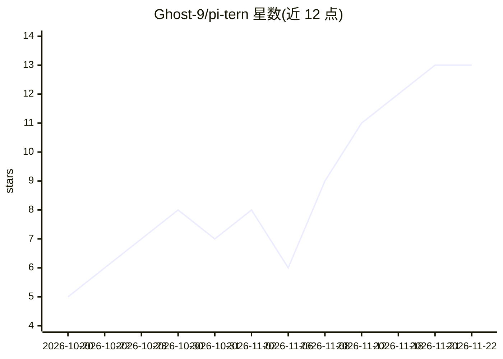

# Ghost-9/pi-tern

⭐ 13 · TypeScript · MIT · 推送 2026-10-31 · [GitHub](https://github.com/Ghost-9/pi-tern) · [官网](https://www.npmjs.com/package/pi-tern) · 个人维护

**为 pi 编码 agent 提供 Tern 终端集成的扩展**

一个把 pi 编码 agent 接入 Tern 终端（Stencil Labs 出品）的扩展：通过 TSP hello 握手让 pi 感知所在终端，提供 Mermaid 图表渲染、WKWebView 浏览器驱动与 PNG 截取、窗格捕获、会话镜像到 Markdown 等能力。另提供 pi-tern launcher 以启用 Tern 原生渲染路径，仅在 agent block 内生效。需要 Tern 0.5.1+（闭测，需 Tern 提供 Stencil 账号）与 pi 1.0+，仅支持 macOS/Linux，且 TSP 相关功能在 tmux/screen/zellij 中不可用。

## 筛选速览

| 维度 | 判定 | 备注 |
|---|---|---|
| AI 角色 | `ai-ecosystem` | LLM/agent 周边工具 |
| 许可风险 | `permissive` | MIT |
| 部署形态 | `desktop` | 安装包/桌面程序 |
| 模型依赖 | — | README 未给出锁定关系 |
| 硬件要求 | — | 无带数字的原话,不猜 |
| 安装摩擦 | `low` | 无编译、无系统依赖或容器化 |
| 成熟度 | — | 结构信号不足 |

## 能力要点

- TSP hello 握手与能力清单（/tern capabilities），按特性检测而非版本锁定
- 驱动 Tern 内置 WKWebView 浏览器并截取 PNG 供模型查看
- Mermaid/图表经 Tern 内置引擎渲染为原生图像块
- tern_fleet 将窗格作为线程管理（spawn/send/read/wait/stop/prune）

## 适用场景

- 在 Tern 终端中渲染对话中的 Mermaid 图表与数据图表
- 让 pi 通过浏览器自动化截取网页 PNG 并读取
- 用窗格管理工具并行运行和监控多个 agent 任务
- 把 agent 会话镜像为 Markdown 存档

## 场景标签

`编码 Agent` `浏览器自动化` · 领域:效率与自动化

## 证据(README 行号)

> L8: Tern integration for the pi coding agent.
> L10: pi is a terminal coding agent. Tern is a terminal by Stencil Labs that renders native UI for programs that speak th
> L68: - **pi 1.0 or newer**, stock **or pi-bolt** (same `@earendil-works/pi-coding-agent` package; the devDependency pins

## 星数曲线

2026-10-20 5 → 2026-11-22 13（+8）

---
*卡片 v1 · prompt 1.4 · 生成 2026-11-18 · 置信度 high · 依据 README sha `0f31f96d7e25` · [字段定义](../../DATASET.md)*
