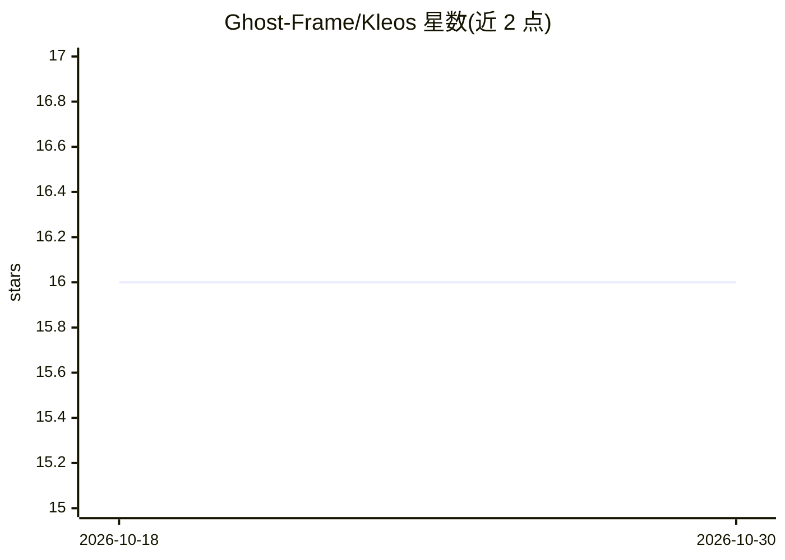

# Ghost-Frame/Kleos

⭐ 16 · Rust · NOASSERTION · 推送 2026-10-26 · [GitHub](https://github.com/Ghost-Frame/Kleos) · [官网](https://kleos.syntheos.dev) · 个人维护

**AI agent 认知基础设施：记忆、图谱、协调与安全的单体服务**

用单个 Rust 二进制提供面向 AI agent 的自托管服务套件：FSRS-6 记忆与六阶段整理、八层并行上下文组装、带因果边的知识图、七个多 agent 协调服务（事件总线、任务、DAG 工作流等）、结构化推理协议、命令与文件系统安全门控及实时监督。首次启动从 Hugging Face 下载 bge-m3 嵌入与重排模型（默认 ONNX 量化，数百 MB）。linux-x64 提供 TUI/GUI 安装器，Windows 用 PowerShell 脚本，其余平台源码构建；系统需 protobuf-compiler。

## 筛选速览

| 维度 | 判定 | 备注 |
|---|---|---|
| AI 角色 | `ai-ecosystem` | LLM/agent 周边工具 |
| 许可风险 | `none` | NOASSERTION |
| 部署形态 | `None` |  |
| 模型依赖 | — | README 未给出锁定关系 |
| 硬件要求 | — | 无带数字的原话,不猜 |
| 安装摩擦 | `medium` | 含编译或系统依赖之一 |
| 成熟度 | — | 结构信号不足 |

## 能力要点

- FSRS-6 间隔重复记忆与六阶段 dream cycle 自动整理
- 8 层并行检索的上下文组装与 token 预算管理
- 七个多 agent 协调服务（Axon/Chiasm/Loom 等）
- shell 命令与文件系统操作经策略引擎门控，SQLCipher 加密

## 适用场景

- 为多 agent 系统提供持久记忆与上下文组装服务
- 需要安全门控与审计的自托管 agent 运行环境
- 多 agent 间的事件总线、任务与工作流协调

## 场景标签

`多智能体` `知识图谱` `Agent 记忆` · 领域:Agent 开发

## 证据(README 行号)

> L5: **Cognitive infrastructure for AI agents. Not a memory engine -- a full operating system for how agents think, learn
> L13: Yes, Kleos stores and retrieves memories. But it also consolidates them overnight through a six-stage dream cycle. 
> L17: One Rust binary. Self-hosted. Your data never leaves your hardware.

## 星数曲线

2026-10-18 16 → 2026-10-30 16（+0）

---
*卡片 v1 · prompt 1.4 · 生成 2026-10-30 · 置信度 high · 依据 README sha `5bee33a66c00` · [字段定义](../../DATASET.md)*
