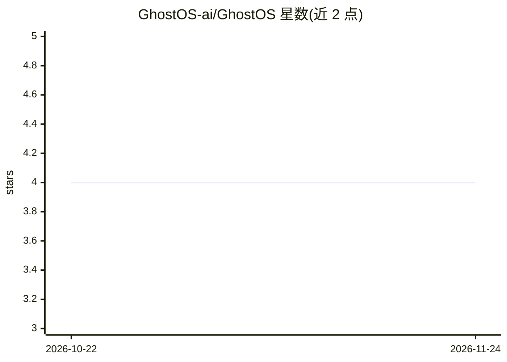

# GhostOS-ai/GhostOS

⭐ 4 · Python · MIT · 推送 2026-11-17 · [GitHub](https://github.com/GhostOS-ai/GhostOS) · [官网](https://github.com/GhostOS-ai/GhostOS) · 个人维护 · 中文 README

**面向低配电脑的轻量本地桌面 AI 助手与自主工作室**

以 Python 包（PyPI）分发的跨平台桌面 AI 伴侣：桌宠形态（Casper）+ Studio 界面，提供对话、代码工程 Agent（GhostCode）、任意应用内的文本改写/翻译热键、SQLite 知识库 RAG（无外部向量库）、会议纪要转录、终端危险命令拦截与跨会话记忆库。支持多模型/云服务商切换（内置离线引擎、Ollama、Gemini、OpenAI、DeepSeek、Claude、OpenAI 兼容端点），VRAM 动态调度峰值不超过 3.5GB，宣称 100% 本地可断网运行，MIT 许可。

## 筛选速览

| 维度 | 判定 | 备注 |
|---|---|---|
| AI 角色 | `ai-native` | 本体是模型或模型工具 |
| 许可风险 | `permissive` | MIT |
| 部署形态 | `library` | 以包/库形式分发 |
| 模型依赖 | local-ok | 支持本地模型 |
| 硬件要求 | — | 无带数字的原话,不猜 |
| 安装摩擦 | `medium` | 含编译或系统依赖之一 |
| 成熟度 | — | 结构信号不足 |

## 能力要点

- 多服务商统一切换：内置引擎/Ollama/Gemini/OpenAI/DeepSeek/Claude/OpenAI 兼容端点
- 零数据库 RAG：文件拖拽摄入，基于 SQLite FTS5 索引
- VRAM 动态调度（LLM/视觉/Whisper 热切换，峰值 3.5GB）与 ECO/平衡/性能电源档位
- GhostCode 自主编码 Agent：读写文件、Unified Diff、运行终端命令与 Git 检查

## 适用场景

- 在 4-8GB 内存的笔记本上运行本地 AI 助手
- 通过桌宠拖拽文件建立本地知识库问答
- 会议中离线生成结构化会议纪要
- 让 Agent 自动规划并修改代码仓库

## 场景标签

`AI 助手` `文档问答` `RAG` `语音识别` · 领域:对话与助手

## 证据(README 行号)

> L36: **A unified, ultra-lightweight desktop AI companion that runs effortlessly on low-spec laptops and base Apple Silic
> L56: * **Unified Model & Cloud Provider Switcher:** Seamlessly toggle between:
> L79: * **Autonomous Software Engineering Loop:** Offline alternative to Claude Code and Cursor. Formulates plans, inspec

## 星数曲线

2026-10-22 4 → 2026-11-24 4（+0）

---
*卡片 v1 · prompt 1.4 · 生成 2026-11-21 · 置信度 high · 依据 README sha `38c2f13caafb` · [字段定义](../../DATASET.md)*
