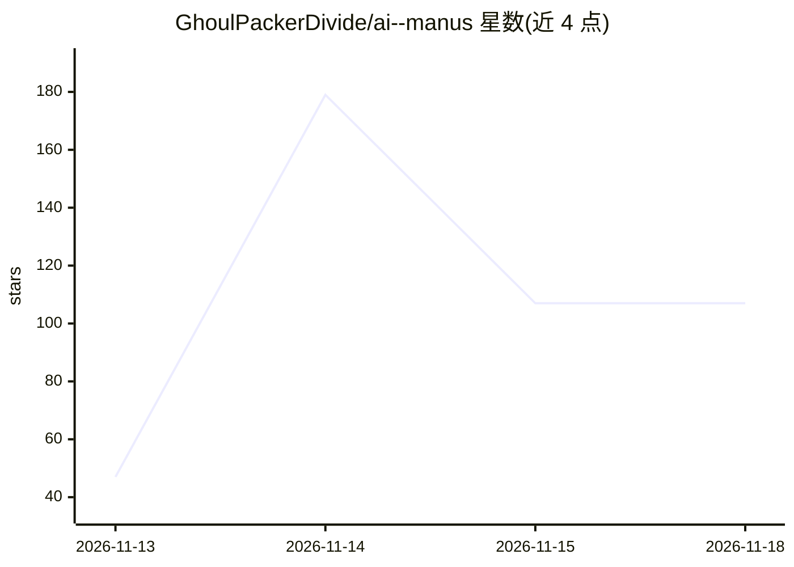

# GhoulPackerDivide/ai--manus

⭐ 107 · Apache-2.0 · 推送 2026-11-15 · [GitHub](https://github.com/GhoulPackerDivide/ai--manus) · 个人维护

**面向日常任务的自主 AI Agent：代写并运行代码、控制浏览器**

Manus 是一个自主 AI agent，按用户指令自行编写并执行脚本、控制浏览器（导航网页、填写表单、采集信息），并可执行多步骤任务，定位为家庭、学习与轻量办公场景的个人助手，而非企业平台或重型开发套件。用户以自然语言描述需求，agent 规划步骤并完成操作，脚本与浏览器动作可在同一流程内衔接。README 仅给出硬件兼容表与使用流程说明，未提供安装命令、源码结构或 API 接入方式等可验证细节。

## 筛选速览

| 维度 | 判定 | 备注 |
|---|---|---|
| AI 角色 | `ai-native` | 本体是模型或模型工具 |
| 许可风险 | `permissive` | Apache-2.0 |
| 部署形态 | `None` |  |
| 模型依赖 | — | README 未给出锁定关系 |
| 硬件要求 | — | 无带数字的原话,不猜 |
| 安装摩擦 | `low` | 无编译、无系统依赖或容器化 |
| 成熟度 | — | 结构信号不足 |

## 能力要点

- 自主编写并执行代码完成任务
- 浏览器控制：导航、填表、采集信息
- 脚本与浏览器动作在同一流程内衔接的多步骤任务
- 面向家庭/学习/轻量办公的小规模场景定位

## 适用场景

- 让 agent 代为收集资料、整理研究笔记并运行小脚本
- 自动填写重复性表单、检查网页更新
- 在不搭建完整开发环境的情况下做快速实验与测试

## 场景标签

`AI 助手` `浏览器自动化` `编码 Agent` · 领域:效率与自动化

## 证据(README 行号)

> L10: - **Autonomous Code Execution:** Manus AI agent runs code on its own to complete tasks, so you can focus on decisio
> L18: Manus is an autonomous AI agent designed to run code and control a browser on your behalf. Instead of acting like a

## 星数曲线

2026-11-13 47 → 2026-11-18 107（+60）

---
*卡片 v1 · prompt 1.4 · 生成 2026-11-17 · 置信度 low · 依据 README sha `a3d88e202bf0` · [字段定义](../../DATASET.md)*
