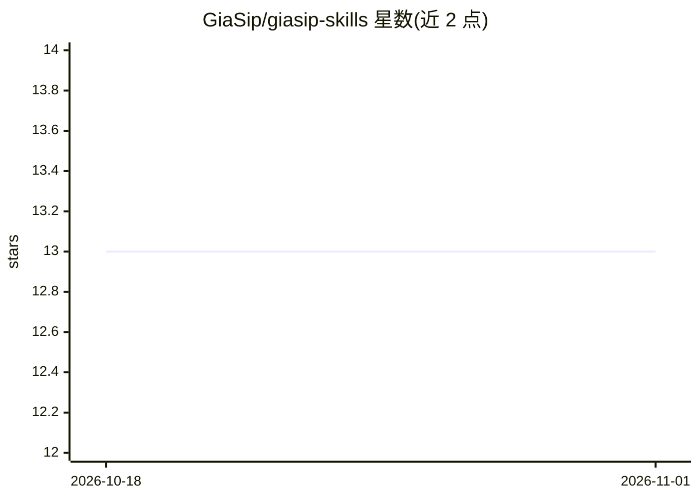

# GiaSip/giasip-skills

⭐ 13 · Shell · MIT · 推送 2026-10-08 · [GitHub](https://github.com/GiaSip/giasip-skills) · [官网](https://github.com/GiaSip/giasip-skills/blob/main/skills/giasip-research/SKILL.md) · 个人维护 · 中文 README

**面向 Claude Code 与 Codex 的研究技能与多模型调度工具集**

仓库包含两个 agent 技能：giasip-research 将研究问题拆分为 2-3 个互补切面，每切面并行运行一个子代理（各限 15 次搜索/抓取，只收集不下结论），汇总为单一 report.md，每个事实附来源 URL，结尾列出待核验事项；giasip-dispatch 是 Claude Code 的多模型调度工具，可通过 OpenRouter/SiliconFlow 聚合 key 或各厂商直连 key，将任务发送到 Codex/Gemini/Kimi/DeepSeek/Qwen/GLM/MiniMax 等模型并取回结果。Research 零外部依赖，复用宿主原生搜索与子代理；Codex 插件仅含 Research。

## 筛选速览

| 维度 | 判定 | 备注 |
|---|---|---|
| AI 角色 | `ai-ecosystem` | LLM/agent 周边工具 |
| 许可风险 | `permissive` | MIT |
| 部署形态 | `library` | 以包/库形式分发 |
| 模型依赖 | locked-api |  |
| 硬件要求 | — | 无带数字的原话,不猜 |
| 安装摩擦 | `low` | 无编译、无系统依赖或容器化 |
| 成熟度 | — | 结构信号不足 |

## 能力要点

- 研究问题拆切面并行子代理，产出带来源链接的 report.md 与 To verify 清单
- giasip-dispatch 支持 OpenRouter/SiliconFlow 聚合 key 及各厂商直连 key 两种路径
- Research 零外部依赖，复用宿主（Claude Code/Codex）原生 WebSearch/WebFetch/SubAgents
- 每切面 15 次抓取预算约束，未找到时输出 not found 而非凭记忆猜测

## 适用场景

- 在 Claude Code 或 Codex 中把一个研究问题变成带引用的报告
- 通过一个聚合 key 调度多家模型执行任务并对比结果
- 为 agent 工作流建立多模型分发通道（API/CLI/SubAgent）

## 场景标签

`科研工具` `模型网关` · 领域:Agent 开发

## 证据(README 行号)

> L8: **Turn a research question into a report with source links and an explicit list of what still needs checking.** GiaS
> L29: |**giasip-dispatch**|A multi-model dispatcher — sends a task or prompt to other AI models (Codex / Gemini / Kimi / 
> L105: **Zero external dependencies — works out of the box.** It uses your host's native web search / fetch tools and sub

## 星数曲线

2026-10-18 13 → 2026-11-01 13（+0）

---
*卡片 v1 · prompt 1.4 · 生成 2026-10-31 · 置信度 high · 依据 README sha `1761852b935b` · [字段定义](../../DATASET.md)*
