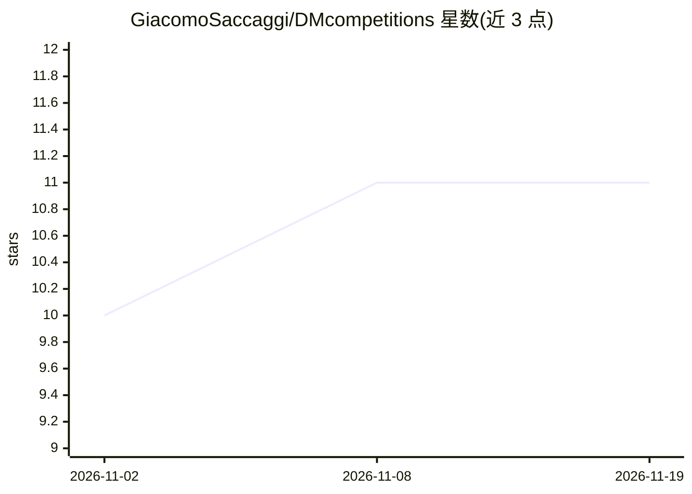

# GiacomoSaccaggi/DMcompetitions

⭐ 11 · HTML · 推送 2026-08-25 · [GitHub](https://github.com/GiacomoSaccaggi/DMcompetitions) · 个人维护

**数据挖掘与机器学习竞赛的解题 notebook 集合**

收集作者参加数据挖掘与机器学习竞赛的解决方案与 Jupyter notebook，按技术分类展示：特征工程与筛选、模型堆叠与混合、超参调优（网格/随机/贝叶斯）、集成方法与交叉验证策略、探索性数据分析。技术栈为 Python、scikit-learn、XGBoost/LightGBM、pandas/NumPy，MIT 许可。README 未列出具体竞赛名称与成绩，也未提供安装运行说明。

## 筛选速览

| 维度 | 判定 | 备注 |
|---|---|---|
| AI 角色 | `ai-knowledge` | 知识聚合/清单类 |
| 许可风险 | `none` | — |
| 部署形态 | `None` |  |
| 模型依赖 | — | README 未给出锁定关系 |
| 硬件要求 | — | 无带数字的原话,不猜 |
| 安装摩擦 | `low` | 无编译、无系统依赖或容器化 |
| 成熟度 | — | 结构信号不足 |

## 能力要点

- 覆盖特征工程、堆叠混合、集成方法的竞赛解题 notebook
- 支持 Grid/Random/Bayesian 三种超参调优方式
- 技术栈基于 scikit-learn 与 XGBoost/LightGBM

## 适用场景

- 学习竞赛中的特征工程与模型集成写法
- 参考交叉验证与调参策略用于自己的竞赛方案

## 场景标签

`教程课程` · 领域:学习与行业

## 证据(README 行号)

> L3: Solutions and notebooks for data mining and machine learning competitions.
> L5: ## Techniques Used

## 星数曲线

2026-11-02 10 → 2026-11-19 11（+1）

---
*卡片 v1 · prompt 1.4 · 生成 2026-11-19 · 置信度 high · 依据 README sha `c34fd57a21d4` · [字段定义](../../DATASET.md)*
